# Model Evaluation Report

All reported test scores are measured on the held-out test split after fitting each model on the training split. The saved champion is selected by validation macro F1, not test scores, to avoid letting majority classes dominate model choice.
Precision, recall, and F1 are shown as both weighted and macro averages; per-class results are included below.
Confusion matrices include raw counts and row-normalized rates.

## Binary classification

| Model | Validation weighted F1 | Validation macro F1 | Accuracy | Weighted precision | Weighted recall | Weighted F1 | Macro precision | Macro recall | Macro F1 | Train time (s) |
|---|---:|---:|---:|---:|---:|---:|---:|---:|---:|---:|
| HIST_GRADIENT_BOOSTING | 98.69% | 90.29% | 98.67% | 98.61% | 98.67% | 98.62% | 92.65% | 87.36% | 89.82% | 2.25 |
| XGBOOST | 98.67% | 90.08% | 98.73% | 98.68% | 98.73% | 98.69% | 93.65% | 87.31% | 90.21% | 0.52 |
| LIGHTGBM | 98.60% | 89.58% | 98.66% | 98.60% | 98.66% | 98.61% | 93.18% | 86.63% | 89.62% | 0.61 |
| CATBOOST | 98.57% | 89.24% | 98.63% | 98.55% | 98.63% | 98.56% | 93.53% | 85.65% | 89.17% | 2.73 |
| RANDOM_FOREST | 98.32% | 87.04% | 98.43% | 98.34% | 98.43% | 98.30% | 94.36% | 81.62% | 86.84% | 1.16 |
| PYTORCH_MLP | 96.60% | 72.11% | 97.14% | 96.66% | 97.14% | 96.66% | 84.66% | 67.08% | 72.64% | 29.81 |
| EXTRA_TREES | 96.52% | 70.12% | 97.22% | 97.02% | 97.22% | 96.48% | 93.29% | 63.11% | 69.62% | 0.84 |

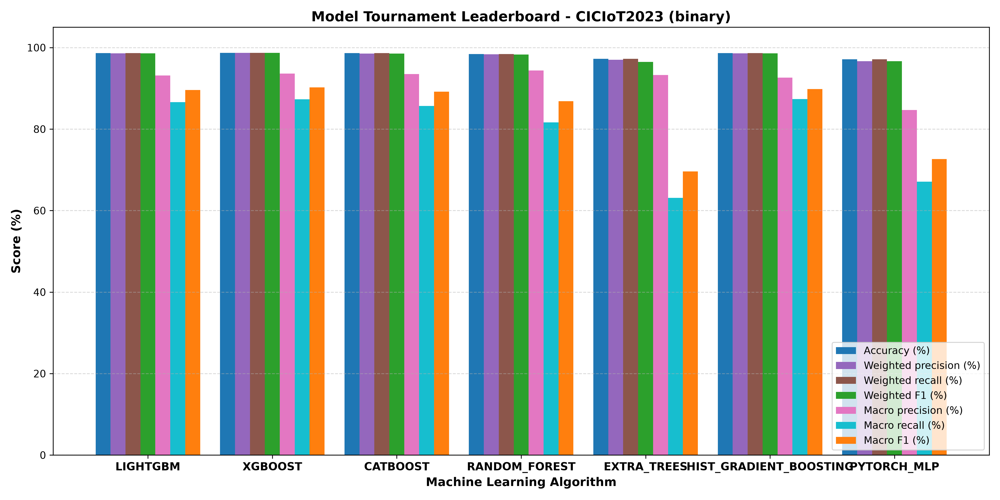

### HIST_GRADIENT_BOOSTING

Test samples: **16598**

| Class | Precision | Recall | F1 score | Support |
|---|---:|---:|---:|---:|
| Attack | 99.07% | 99.55% | 99.31% | 15998 |
| Benign | 86.23% | 75.17% | 80.32% | 600 |

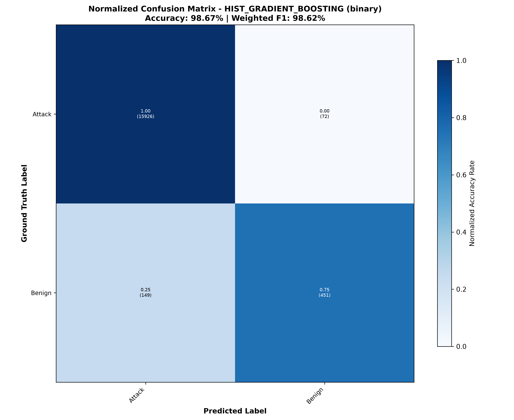

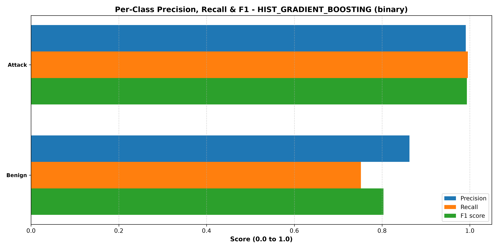

Data: [Raw confusion matrix CSV](../metrics/confusion_matrix_HIST_GRADIENT_BOOSTING_binary.csv), [Normalized confusion matrix CSV](../metrics/confusion_matrix_normalized_HIST_GRADIENT_BOOSTING_binary.csv), [Per-class metrics CSV](../metrics/class_metrics_HIST_GRADIENT_BOOSTING_binary.csv)

### XGBOOST

Test samples: **16598**

| Class | Precision | Recall | F1 score | Support |
|---|---:|---:|---:|---:|
| Attack | 99.07% | 99.62% | 99.35% | 15998 |
| Benign | 88.24% | 75.00% | 81.08% | 600 |

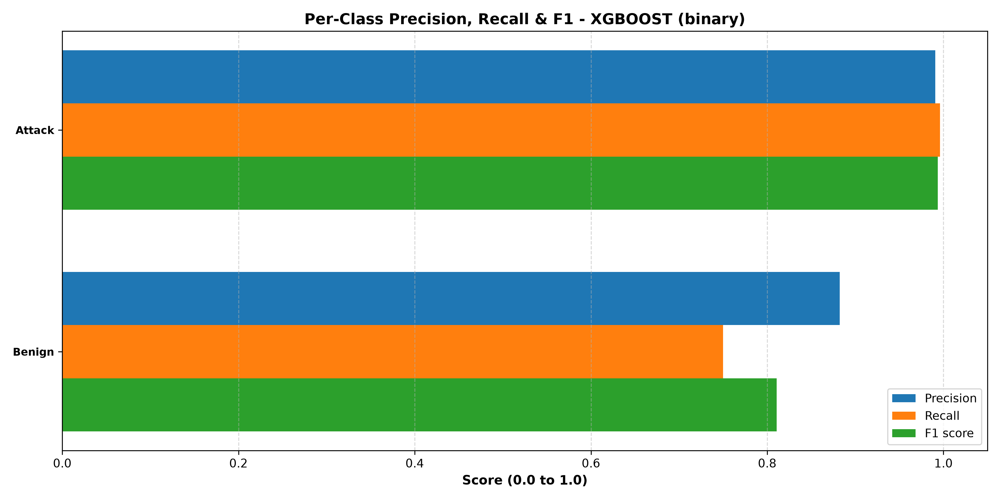

Data: [Raw confusion matrix CSV](../metrics/confusion_matrix_XGBOOST_binary.csv), [Normalized confusion matrix CSV](../metrics/confusion_matrix_normalized_XGBOOST_binary.csv), [Per-class metrics CSV](../metrics/class_metrics_XGBOOST_binary.csv)

### LIGHTGBM

Test samples: **16598**

| Class | Precision | Recall | F1 score | Support |
|---|---:|---:|---:|---:|
| Attack | 99.02% | 99.60% | 99.31% | 15998 |
| Benign | 87.35% | 73.67% | 79.93% | 600 |

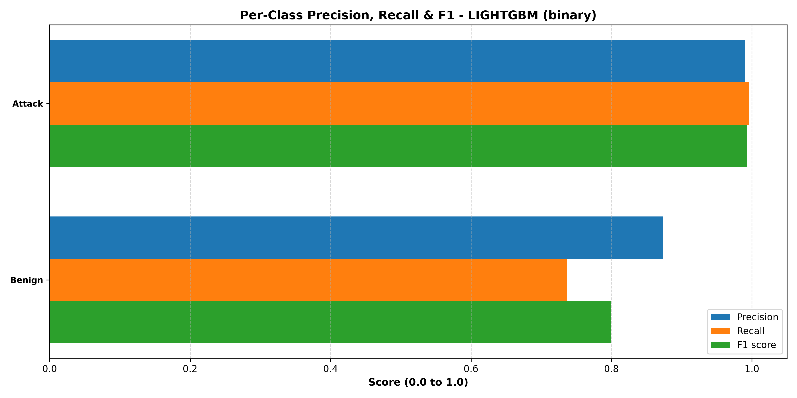

Data: [Raw confusion matrix CSV](../metrics/confusion_matrix_LIGHTGBM_binary.csv), [Normalized confusion matrix CSV](../metrics/confusion_matrix_normalized_LIGHTGBM_binary.csv), [Per-class metrics CSV](../metrics/class_metrics_LIGHTGBM_binary.csv)

### CATBOOST

Test samples: **16598**

| Class | Precision | Recall | F1 score | Support |
|---|---:|---:|---:|---:|
| Attack | 98.94% | 99.64% | 99.29% | 15998 |
| Benign | 88.11% | 71.67% | 79.04% | 600 |

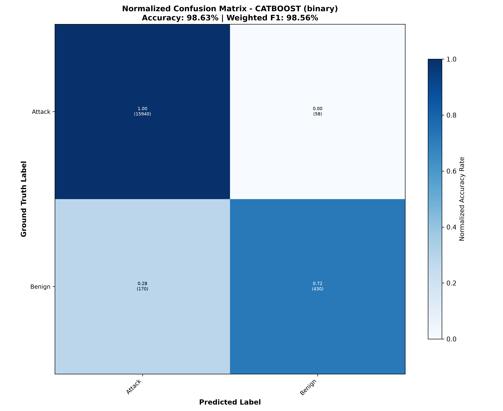

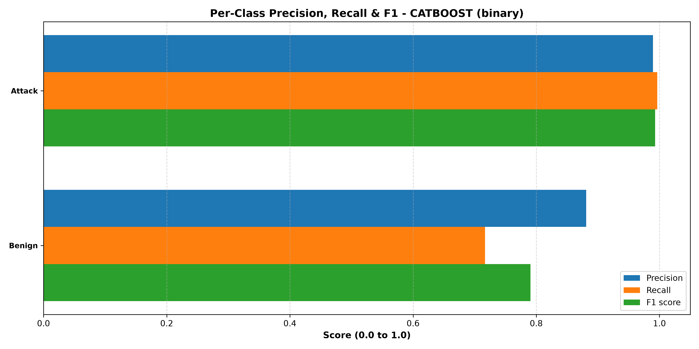

Data: [Raw confusion matrix CSV](../metrics/confusion_matrix_CATBOOST_binary.csv), [Normalized confusion matrix CSV](../metrics/confusion_matrix_normalized_CATBOOST_binary.csv), [Per-class metrics CSV](../metrics/class_metrics_CATBOOST_binary.csv)

### RANDOM_FOREST

Test samples: **16598**

| Class | Precision | Recall | F1 score | Support |
|---|---:|---:|---:|---:|
| Attack | 98.65% | 99.74% | 99.19% | 15998 |
| Benign | 90.07% | 63.50% | 74.49% | 600 |

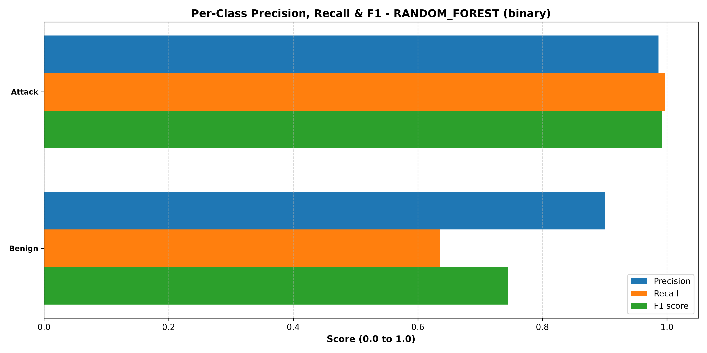

Data: [Raw confusion matrix CSV](../metrics/confusion_matrix_RANDOM_FOREST_binary.csv), [Normalized confusion matrix CSV](../metrics/confusion_matrix_normalized_RANDOM_FOREST_binary.csv), [Per-class metrics CSV](../metrics/class_metrics_RANDOM_FOREST_binary.csv)

### PYTORCH_MLP

Test samples: **16598**

| Class | Precision | Recall | F1 score | Support |
|---|---:|---:|---:|---:|
| Attack | 97.60% | 99.49% | 98.53% | 15998 |
| Benign | 71.72% | 34.67% | 46.74% | 600 |

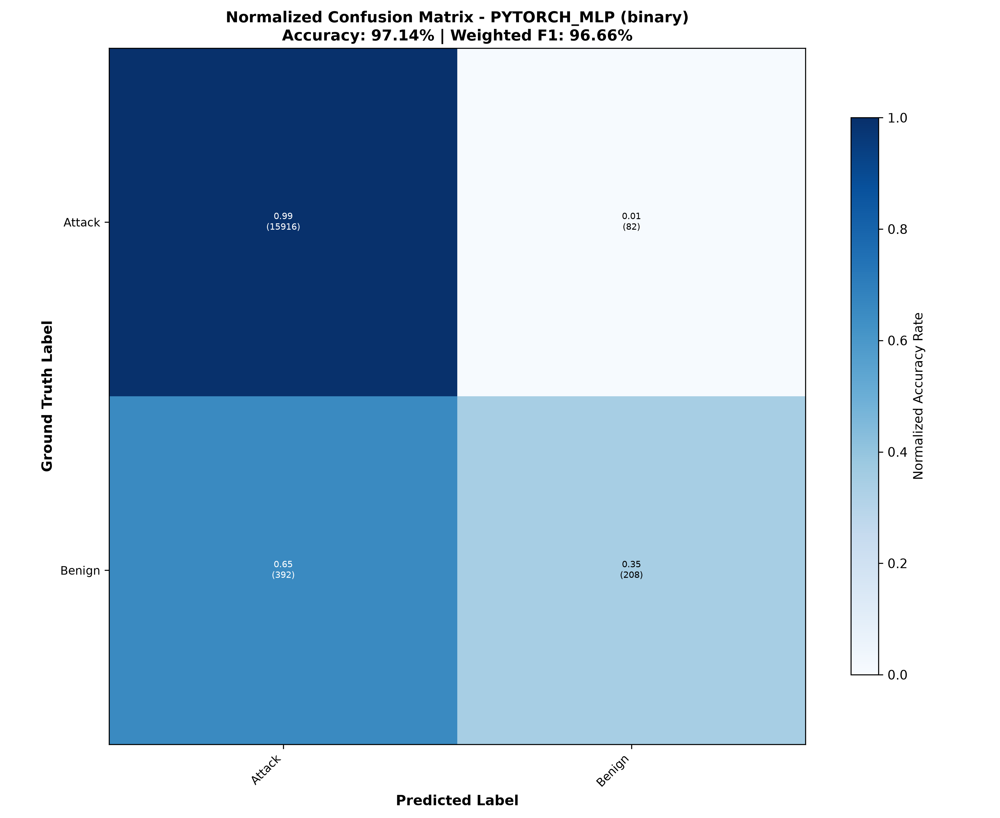

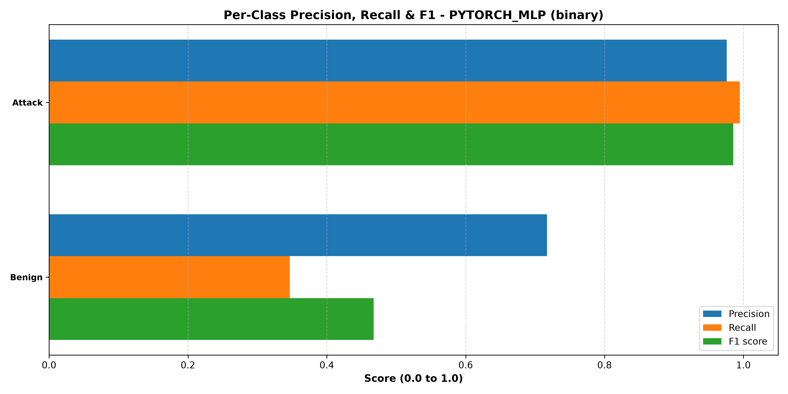

Data: [Raw confusion matrix CSV](../metrics/confusion_matrix_PYTORCH_MLP_binary.csv), [Normalized confusion matrix CSV](../metrics/confusion_matrix_normalized_PYTORCH_MLP_binary.csv), [Per-class metrics CSV](../metrics/class_metrics_PYTORCH_MLP_binary.csv)

### EXTRA_TREES

Test samples: **16598**

| Class | Precision | Recall | F1 score | Support |
|---|---:|---:|---:|---:|
| Attack | 97.31% | 99.88% | 98.58% | 15998 |
| Benign | 89.27% | 26.33% | 40.67% | 600 |

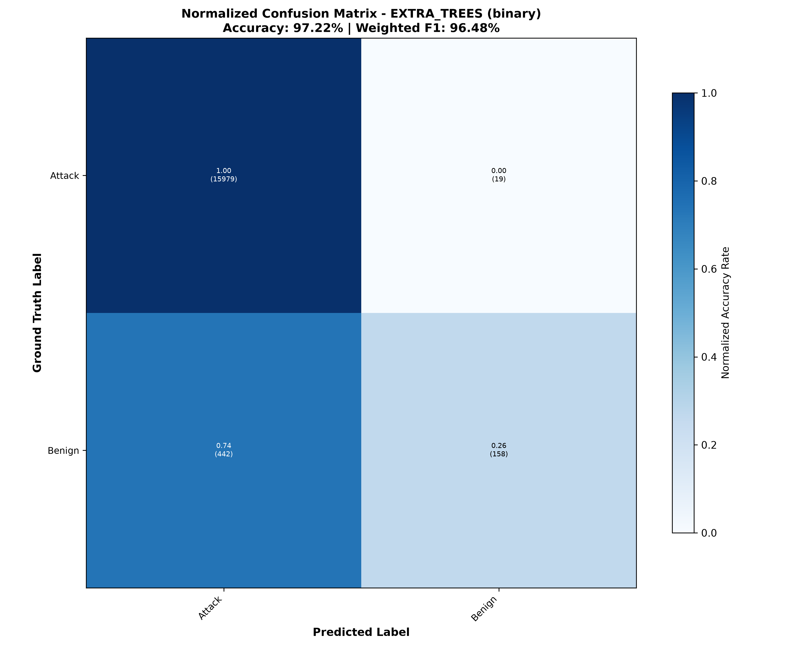

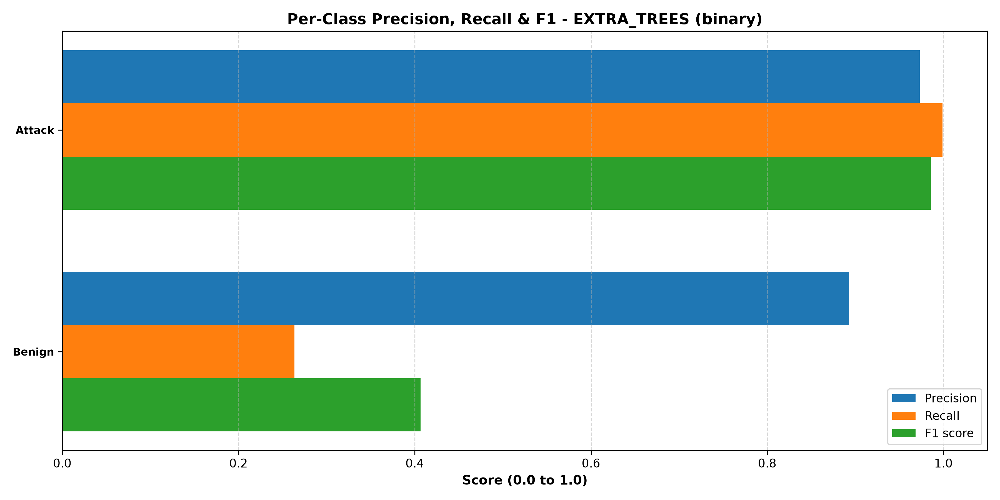

Data: [Raw confusion matrix CSV](../metrics/confusion_matrix_EXTRA_TREES_binary.csv), [Normalized confusion matrix CSV](../metrics/confusion_matrix_normalized_EXTRA_TREES_binary.csv), [Per-class metrics CSV](../metrics/class_metrics_EXTRA_TREES_binary.csv)

## Binary_Shared_1000 classification

| Model | Validation weighted F1 | Validation macro F1 | Accuracy | Weighted precision | Weighted recall | Weighted F1 | Macro precision | Macro recall | Macro F1 | Train time (s) |
|---|---:|---:|---:|---:|---:|---:|---:|---:|---:|---:|
| HIST_GRADIENT_BOOSTING | 97.65% | 81.57% | 97.88% | 97.67% | 97.88% | 97.66% | 90.03% | 76.36% | 81.68% | 0.16 |
| LIGHTGBM | 97.67% | 81.36% | 97.96% | 97.79% | 97.96% | 97.73% | 91.92% | 76.08% | 82.02% | 0.11 |
| CATBOOST | 97.36% | 78.36% | 97.84% | 97.70% | 97.84% | 97.49% | 94.14% | 72.41% | 79.48% | 0.42 |
| XGBOOST | 97.29% | 77.94% | 97.78% | 97.56% | 97.78% | 97.47% | 91.36% | 73.34% | 79.65% | 0.2 |
| PYTORCH_MLP | 95.93% | 69.32% | 96.31% | 95.84% | 96.31% | 96.04% | 73.12% | 67.13% | 69.63% | 0.42 |
| RANDOM_FOREST | 96.23% | 67.35% | 97.04% | 96.63% | 97.04% | 96.25% | 89.18% | 61.73% | 67.57% | 0.16 |
| EXTRA_TREES | 95.87% | 63.87% | 96.92% | 96.36% | 96.92% | 96.08% | 86.36% | 60.70% | 66.05% | 0.12 |
| FT_TRANSFORMER_FROM_SCRATCH | 94.61% | 49.08% | 96.39% | 92.90% | 96.39% | 94.61% | 48.19% | 50.00% | 49.08% | 3.57 |

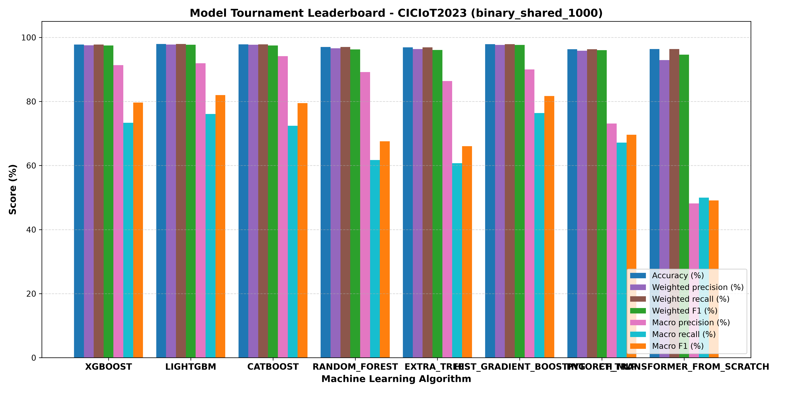

### HIST_GRADIENT_BOOSTING

Test samples: **16598**

| Class | Precision | Recall | F1 score | Support |
|---|---:|---:|---:|---:|
| Attack | 98.27% | 99.56% | 98.91% | 15998 |
| Benign | 81.79% | 53.17% | 64.44% | 600 |

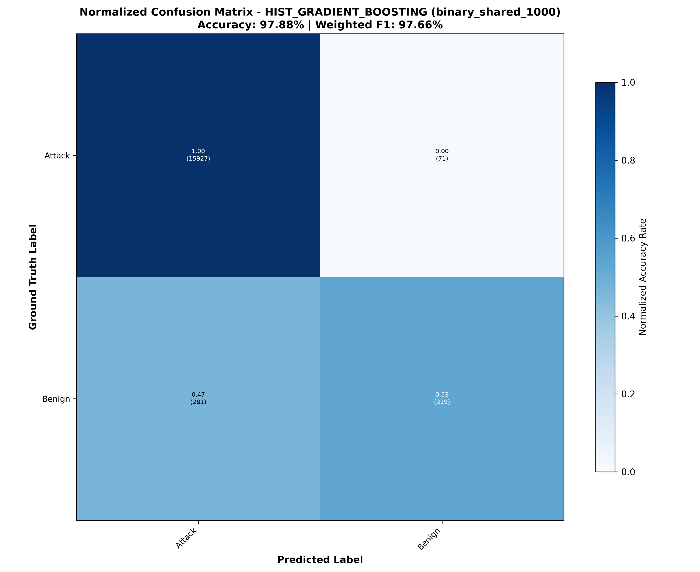

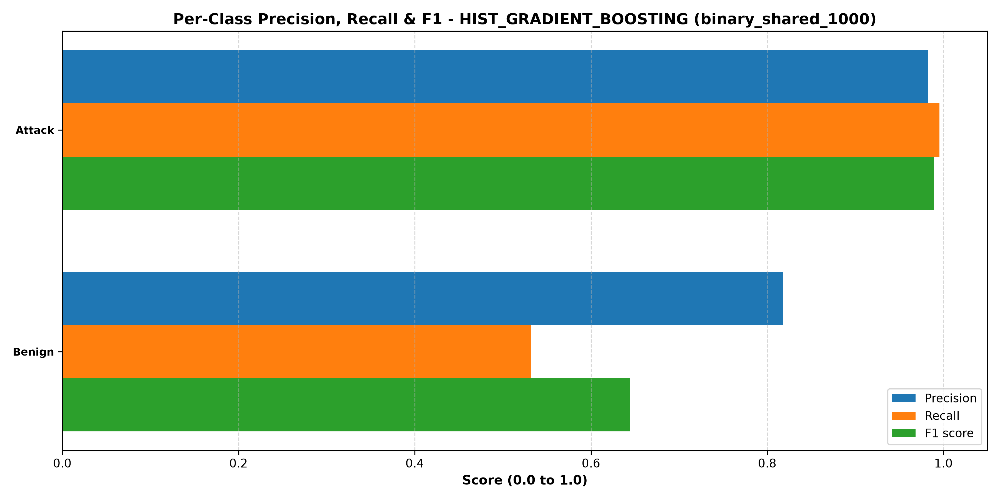

Data: [Raw confusion matrix CSV](../metrics/confusion_matrix_HIST_GRADIENT_BOOSTING_binary_shared_1000.csv), [Normalized confusion matrix CSV](../metrics/confusion_matrix_normalized_HIST_GRADIENT_BOOSTING_binary_shared_1000.csv), [Per-class metrics CSV](../metrics/class_metrics_HIST_GRADIENT_BOOSTING_binary_shared_1000.csv)

### LIGHTGBM

Test samples: **16598**

| Class | Precision | Recall | F1 score | Support |
|---|---:|---:|---:|---:|
| Attack | 98.24% | 99.67% | 98.95% | 15998 |
| Benign | 85.60% | 52.50% | 65.08% | 600 |

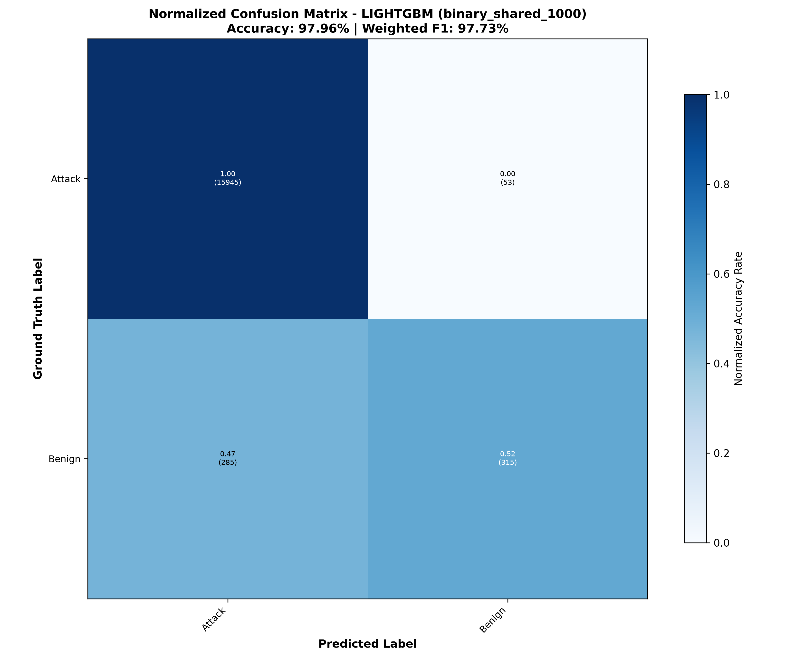

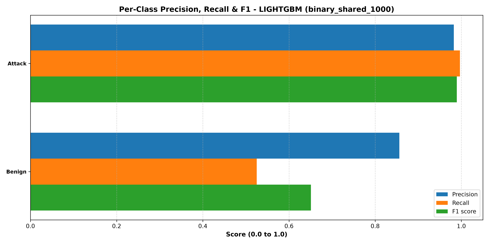

Data: [Raw confusion matrix CSV](../metrics/confusion_matrix_LIGHTGBM_binary_shared_1000.csv), [Normalized confusion matrix CSV](../metrics/confusion_matrix_normalized_LIGHTGBM_binary_shared_1000.csv), [Per-class metrics CSV](../metrics/class_metrics_LIGHTGBM_binary_shared_1000.csv)

### CATBOOST

Test samples: **16598**

| Class | Precision | Recall | F1 score | Support |
|---|---:|---:|---:|---:|
| Attack | 97.98% | 99.82% | 98.89% | 15998 |
| Benign | 90.30% | 45.00% | 60.07% | 600 |

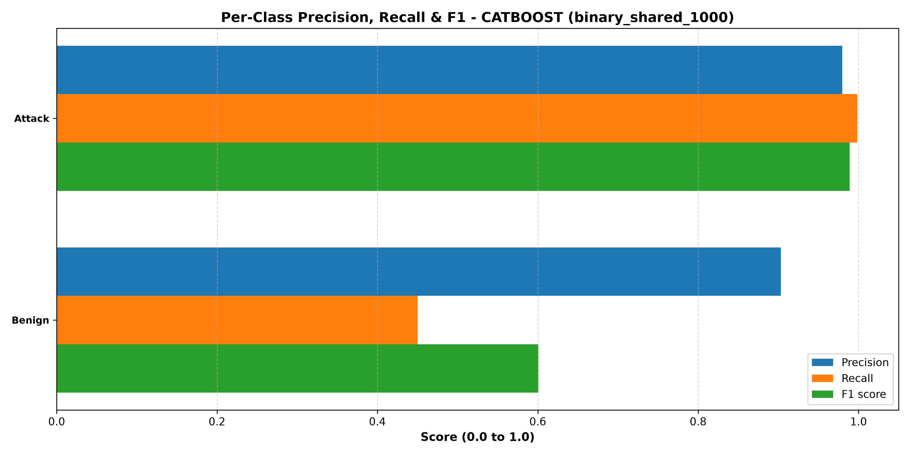

Data: [Raw confusion matrix CSV](../metrics/confusion_matrix_CATBOOST_binary_shared_1000.csv), [Normalized confusion matrix CSV](../metrics/confusion_matrix_normalized_CATBOOST_binary_shared_1000.csv), [Per-class metrics CSV](../metrics/class_metrics_CATBOOST_binary_shared_1000.csv)

### XGBOOST

Test samples: **16598**

| Class | Precision | Recall | F1 score | Support |
|---|---:|---:|---:|---:|
| Attack | 98.04% | 99.68% | 98.86% | 15998 |
| Benign | 84.68% | 47.00% | 60.45% | 600 |

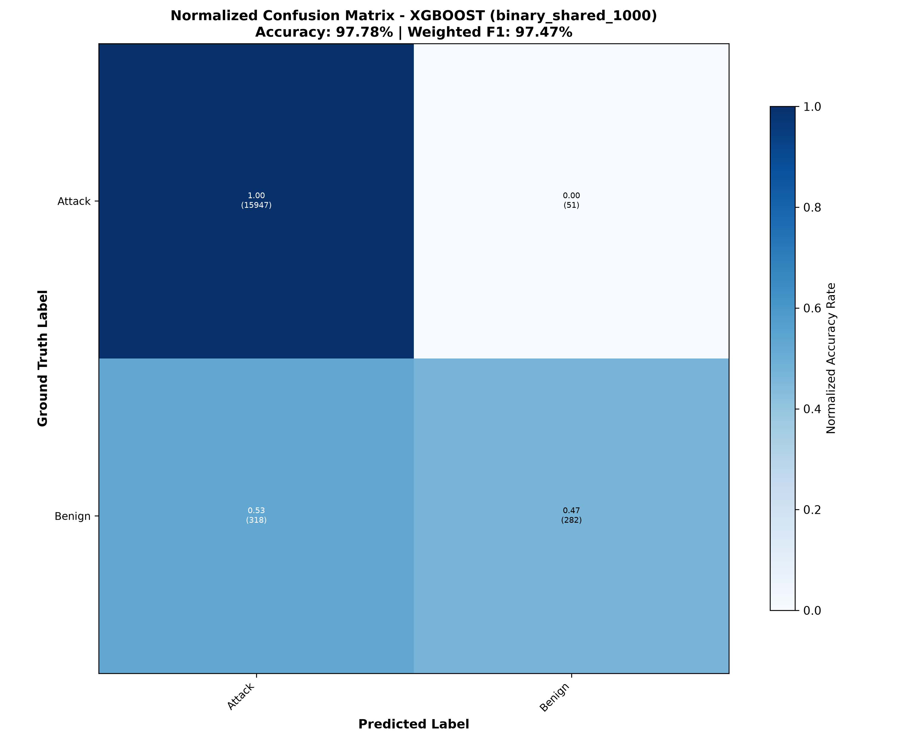

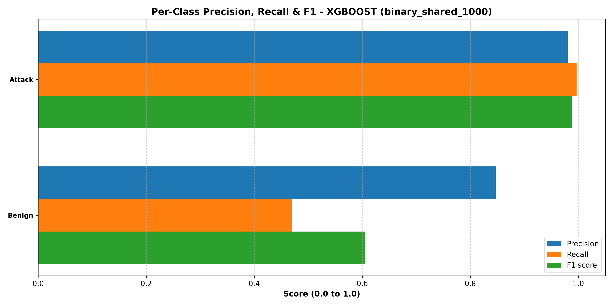

Data: [Raw confusion matrix CSV](../metrics/confusion_matrix_XGBOOST_binary_shared_1000.csv), [Normalized confusion matrix CSV](../metrics/confusion_matrix_normalized_XGBOOST_binary_shared_1000.csv), [Per-class metrics CSV](../metrics/class_metrics_XGBOOST_binary_shared_1000.csv)

### PYTORCH_MLP

Test samples: **16598**

| Class | Precision | Recall | F1 score | Support |
|---|---:|---:|---:|---:|
| Attack | 97.61% | 98.59% | 98.10% | 15998 |
| Benign | 48.64% | 35.67% | 41.15% | 600 |

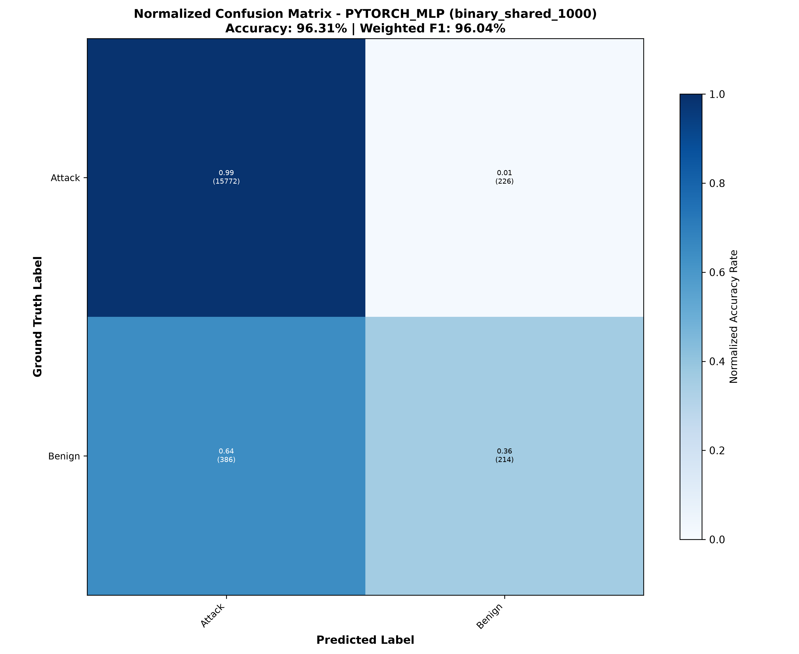

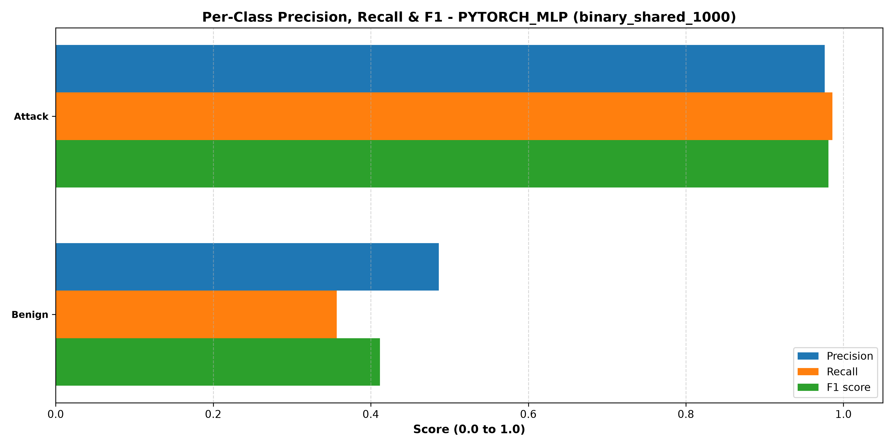

Data: [Raw confusion matrix CSV](../metrics/confusion_matrix_PYTORCH_MLP_binary_shared_1000.csv), [Normalized confusion matrix CSV](../metrics/confusion_matrix_normalized_PYTORCH_MLP_binary_shared_1000.csv), [Per-class metrics CSV](../metrics/class_metrics_PYTORCH_MLP_binary_shared_1000.csv)

### RANDOM_FOREST

Test samples: **16598**

| Class | Precision | Recall | F1 score | Support |
|---|---:|---:|---:|---:|
| Attack | 97.21% | 99.79% | 98.49% | 15998 |
| Benign | 81.14% | 23.67% | 36.65% | 600 |

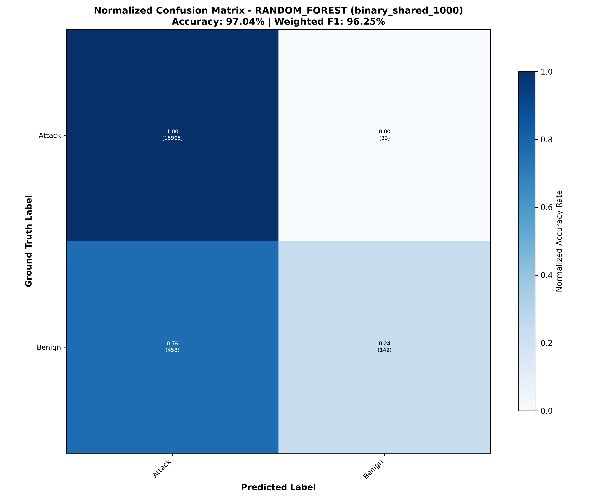

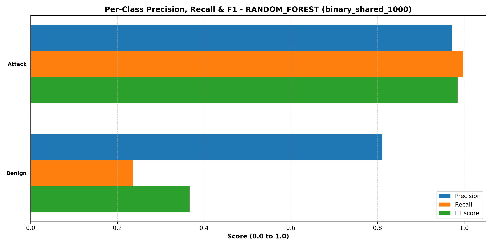

Data: [Raw confusion matrix CSV](../metrics/confusion_matrix_RANDOM_FOREST_binary_shared_1000.csv), [Normalized confusion matrix CSV](../metrics/confusion_matrix_normalized_RANDOM_FOREST_binary_shared_1000.csv), [Per-class metrics CSV](../metrics/class_metrics_RANDOM_FOREST_binary_shared_1000.csv)

### EXTRA_TREES

Test samples: **16598**

| Class | Precision | Recall | F1 score | Support |
|---|---:|---:|---:|---:|
| Attack | 97.14% | 99.74% | 98.42% | 15998 |
| Benign | 75.58% | 21.67% | 33.68% | 600 |

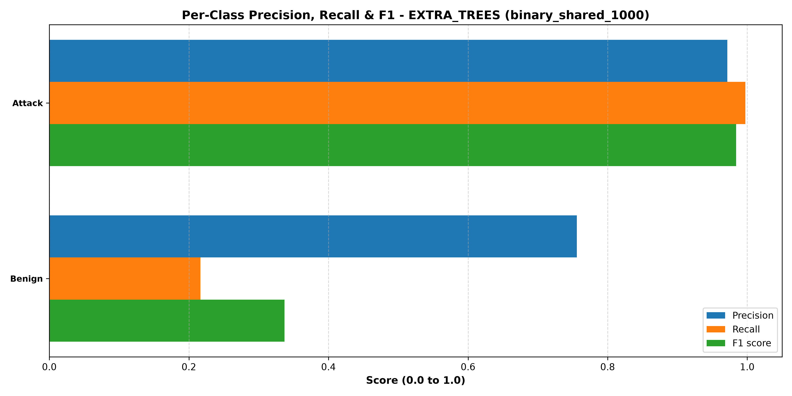

Data: [Raw confusion matrix CSV](../metrics/confusion_matrix_EXTRA_TREES_binary_shared_1000.csv), [Normalized confusion matrix CSV](../metrics/confusion_matrix_normalized_EXTRA_TREES_binary_shared_1000.csv), [Per-class metrics CSV](../metrics/class_metrics_EXTRA_TREES_binary_shared_1000.csv)

### FT_TRANSFORMER_FROM_SCRATCH

Test samples: **16598**

| Class | Precision | Recall | F1 score | Support |
|---|---:|---:|---:|---:|
| Attack | 96.39% | 100.00% | 98.16% | 15998 |
| Benign | 0.00% | 0.00% | 0.00% | 600 |

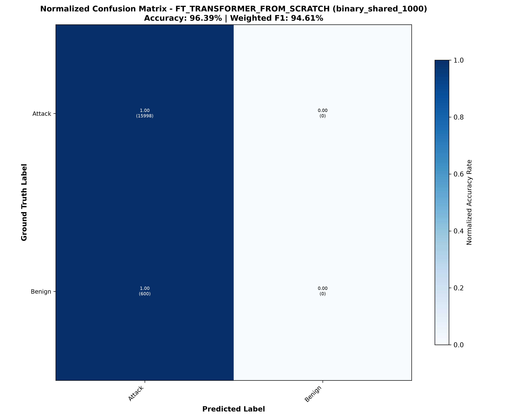

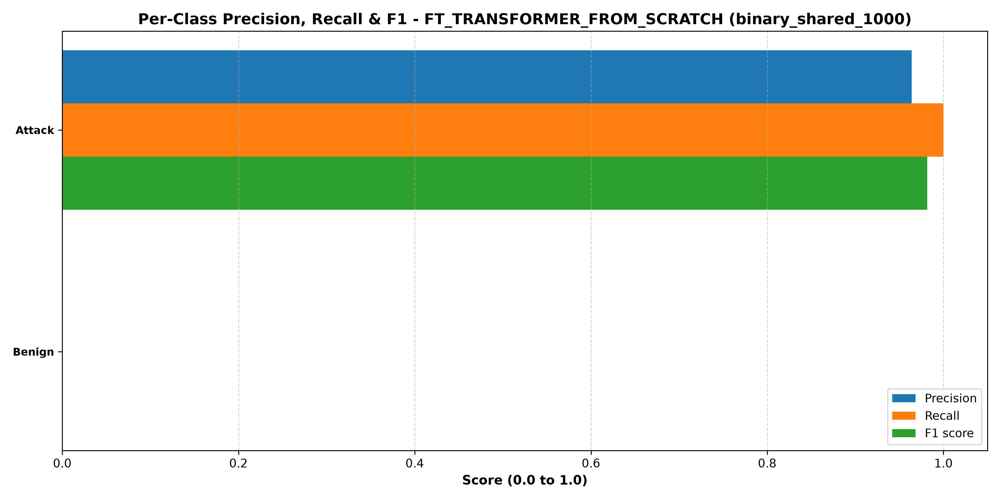

Data: [Raw confusion matrix CSV](../metrics/confusion_matrix_FT_TRANSFORMER_FROM_SCRATCH_binary_shared_1000.csv), [Normalized confusion matrix CSV](../metrics/confusion_matrix_normalized_FT_TRANSFORMER_FROM_SCRATCH_binary_shared_1000.csv), [Per-class metrics CSV](../metrics/class_metrics_FT_TRANSFORMER_FROM_SCRATCH_binary_shared_1000.csv)

## Category classification

| Model | Validation weighted F1 | Validation macro F1 | Accuracy | Weighted precision | Weighted recall | Weighted F1 | Macro precision | Macro recall | Macro F1 | Train time (s) |
|---|---:|---:|---:|---:|---:|---:|---:|---:|---:|---:|
| LIGHTGBM | 95.62% | 89.18% | 95.44% | 95.47% | 95.44% | 95.40% | 90.14% | 87.33% | 88.53% | 6.76 |
| HIST_GRADIENT_BOOSTING | 95.58% | 88.97% | 95.53% | 95.54% | 95.53% | 95.51% | 89.90% | 87.93% | 88.79% | 6.5 |
| XGBOOST | 95.51% | 88.82% | 95.51% | 95.56% | 95.51% | 95.47% | 90.84% | 87.46% | 88.86% | 6.76 |
| CATBOOST | 94.53% | 86.81% | 94.73% | 94.86% | 94.73% | 94.62% | 90.71% | 84.48% | 86.74% | 7.33 |
| RANDOM_FOREST | 94.16% | 85.33% | 94.29% | 94.42% | 94.29% | 94.14% | 89.96% | 82.85% | 85.48% | 1.64 |
| EXTRA_TREES | 79.94% | 68.99% | 81.93% | 83.76% | 81.93% | 79.82% | 85.49% | 65.26% | 69.79% | 1.04 |
| PYTORCH_MLP | 77.95% | 65.80% | 78.76% | 79.09% | 78.76% | 77.74% | 74.47% | 64.91% | 66.30% | 28.02 |

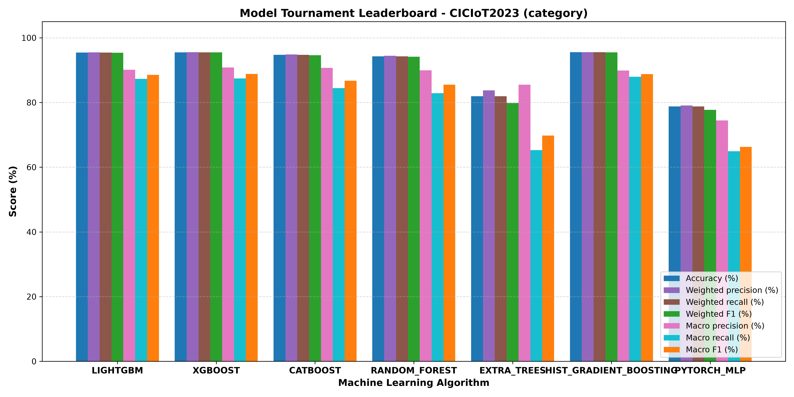

### LIGHTGBM

Test samples: **16598**

| Class | Precision | Recall | F1 score | Support |
|---|---:|---:|---:|---:|
| Benign | 84.50% | 78.17% | 81.21% | 600 |
| Brute_Force | 87.45% | 67.71% | 76.33% | 319 |
| DDoS | 99.93% | 99.97% | 99.95% | 7200 |
| DoS | 99.96% | 99.83% | 99.90% | 2400 |
| Mirai | 100.00% | 100.00% | 100.00% | 1800 |
| Recon | 87.18% | 92.91% | 89.95% | 2453 |
| Spoofing | 89.34% | 83.83% | 86.50% | 1200 |
| Web_Attack | 72.71% | 76.20% | 74.41% | 626 |

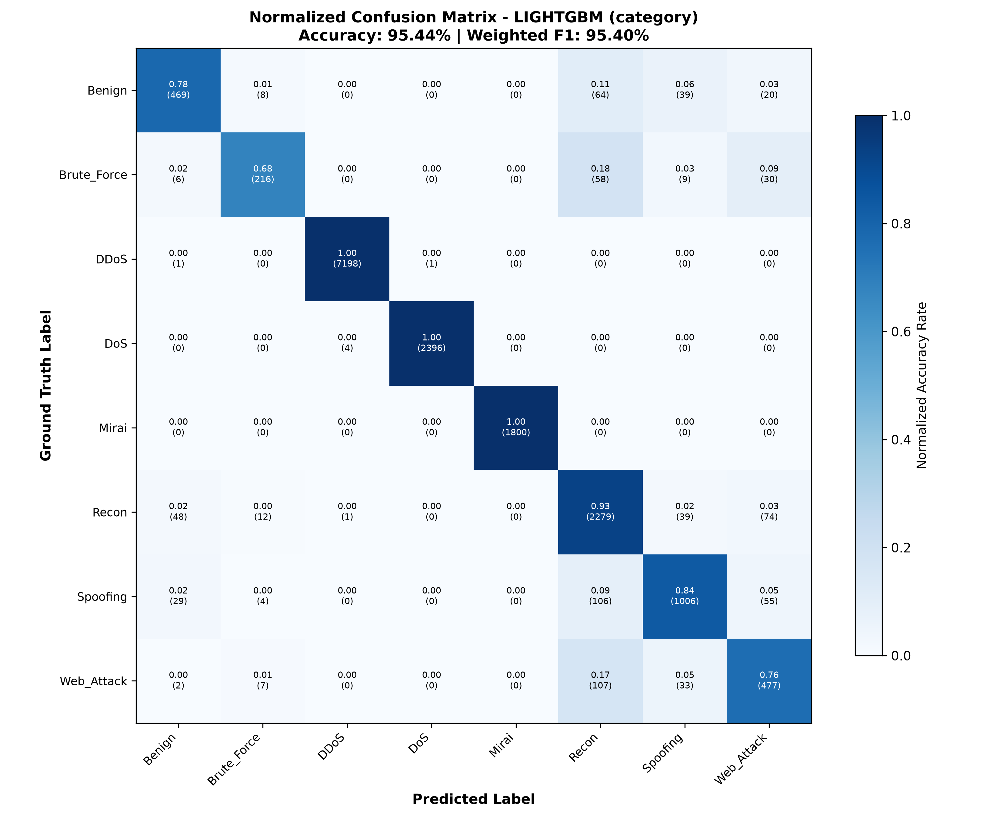

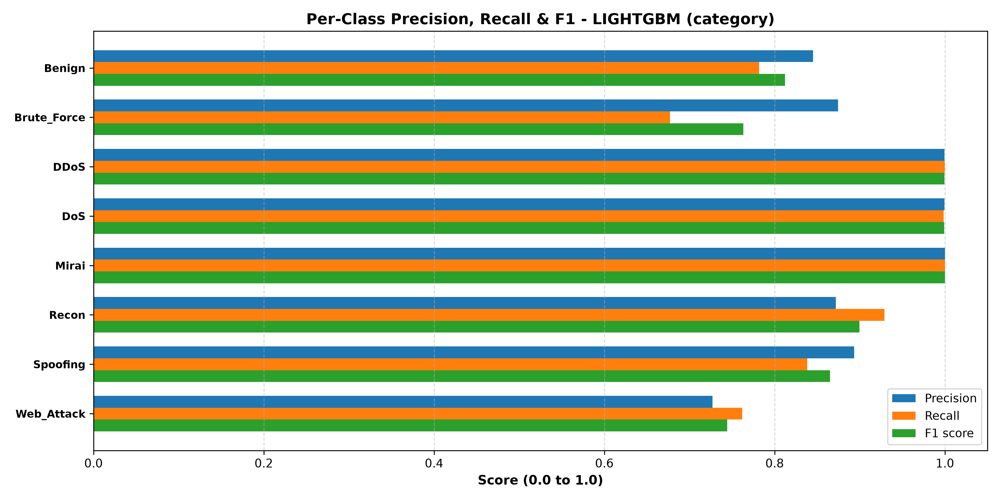

Data: [Raw confusion matrix CSV](../metrics/confusion_matrix_LIGHTGBM_category.csv), [Normalized confusion matrix CSV](../metrics/confusion_matrix_normalized_LIGHTGBM_category.csv), [Per-class metrics CSV](../metrics/class_metrics_LIGHTGBM_category.csv)

### HIST_GRADIENT_BOOSTING

Test samples: **16598**

| Class | Precision | Recall | F1 score | Support |
|---|---:|---:|---:|---:|
| Benign | 83.36% | 79.33% | 81.30% | 600 |
| Brute_Force | 85.06% | 69.59% | 76.55% | 319 |
| DDoS | 99.99% | 99.97% | 99.98% | 7200 |
| DoS | 100.00% | 100.00% | 100.00% | 2400 |
| Mirai | 100.00% | 99.94% | 99.97% | 1800 |
| Recon | 88.04% | 92.13% | 90.04% | 2453 |
| Spoofing | 88.69% | 84.33% | 86.46% | 1200 |
| Web_Attack | 74.09% | 78.12% | 76.05% | 626 |

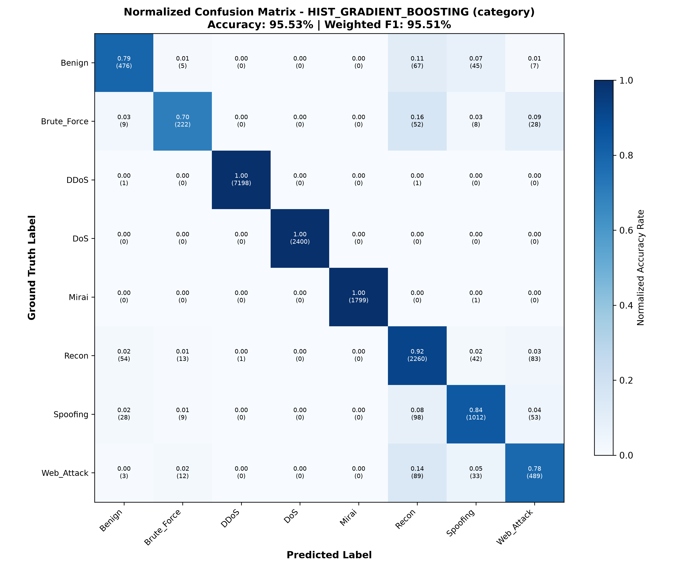

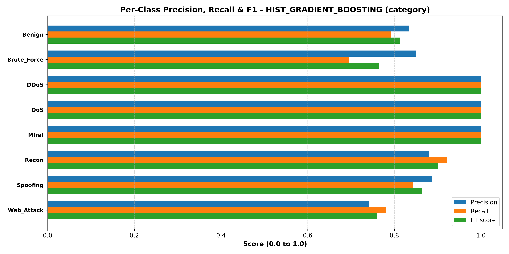

Data: [Raw confusion matrix CSV](../metrics/confusion_matrix_HIST_GRADIENT_BOOSTING_category.csv), [Normalized confusion matrix CSV](../metrics/confusion_matrix_normalized_HIST_GRADIENT_BOOSTING_category.csv), [Per-class metrics CSV](../metrics/class_metrics_HIST_GRADIENT_BOOSTING_category.csv)

### XGBOOST

Test samples: **16598**

| Class | Precision | Recall | F1 score | Support |
|---|---:|---:|---:|---:|
| Benign | 84.42% | 79.50% | 81.89% | 600 |
| Brute_Force | 92.24% | 67.08% | 77.68% | 319 |
| DDoS | 99.96% | 99.97% | 99.97% | 7200 |
| DoS | 99.96% | 99.88% | 99.92% | 2400 |
| Mirai | 100.00% | 99.94% | 99.97% | 1800 |
| Recon | 86.72% | 92.91% | 89.71% | 2453 |
| Spoofing | 89.48% | 84.33% | 86.83% | 1200 |
| Web_Attack | 73.91% | 76.04% | 74.96% | 626 |

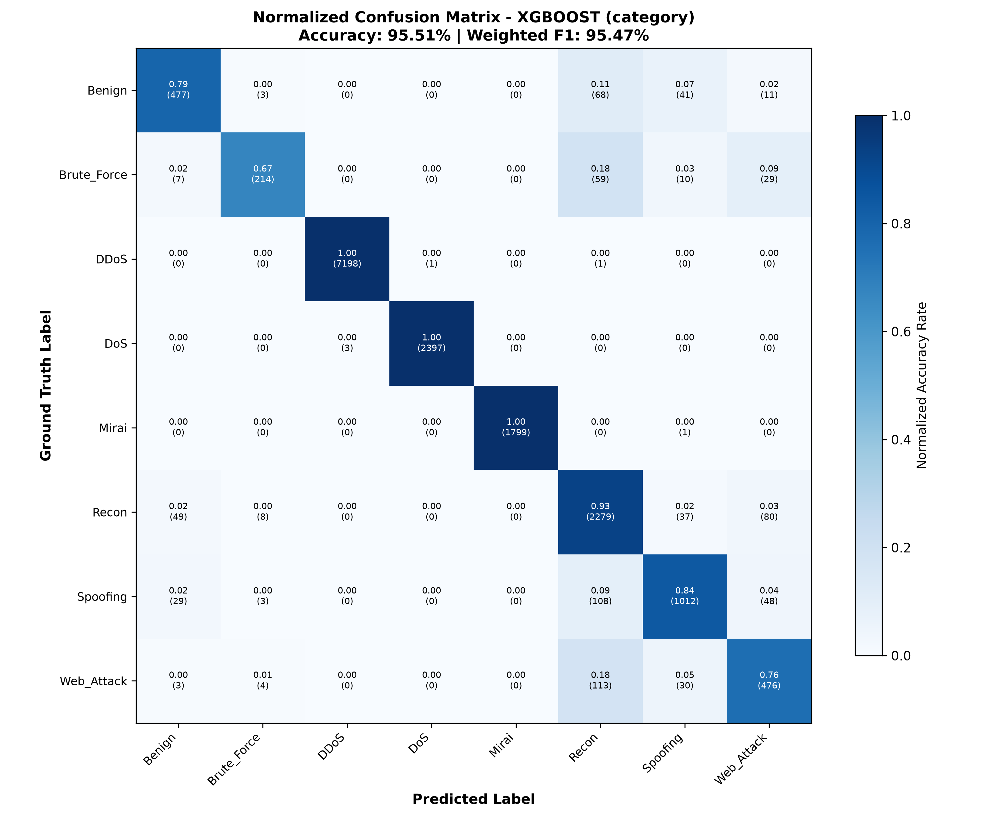

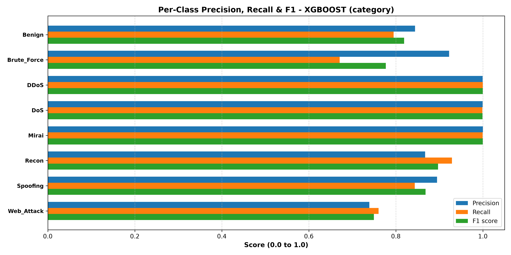

Data: [Raw confusion matrix CSV](../metrics/confusion_matrix_XGBOOST_category.csv), [Normalized confusion matrix CSV](../metrics/confusion_matrix_normalized_XGBOOST_category.csv), [Per-class metrics CSV](../metrics/class_metrics_XGBOOST_category.csv)

### CATBOOST

Test samples: **16598**

| Class | Precision | Recall | F1 score | Support |
|---|---:|---:|---:|---:|
| Benign | 81.40% | 75.83% | 78.52% | 600 |
| Brute_Force | 98.31% | 54.55% | 70.16% | 319 |
| DDoS | 99.89% | 99.78% | 99.83% | 7200 |
| DoS | 99.79% | 99.79% | 99.79% | 2400 |
| Mirai | 99.78% | 99.61% | 99.69% | 1800 |
| Recon | 83.15% | 93.11% | 87.85% | 2453 |
| Spoofing | 86.55% | 83.67% | 85.08% | 1200 |
| Web_Attack | 76.86% | 69.49% | 72.99% | 626 |

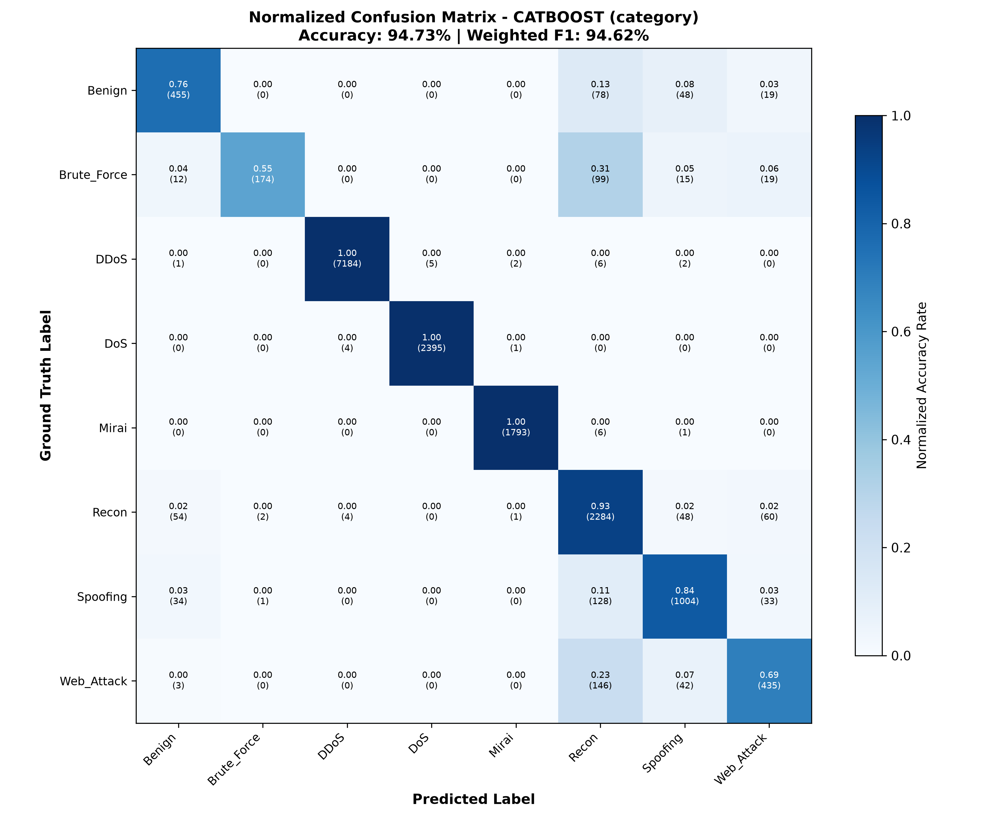

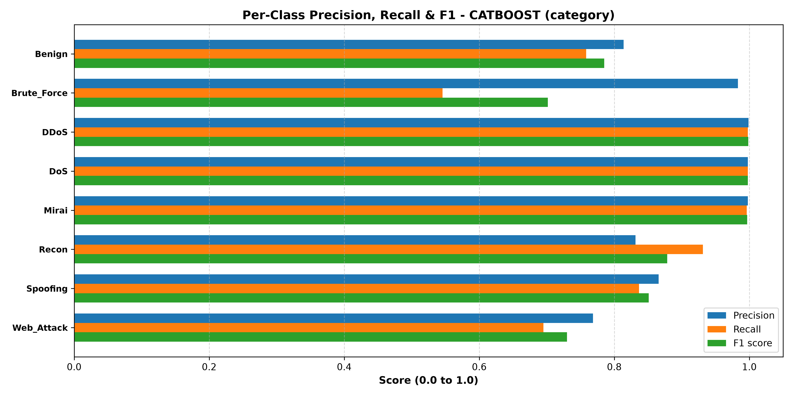

Data: [Raw confusion matrix CSV](../metrics/confusion_matrix_CATBOOST_category.csv), [Normalized confusion matrix CSV](../metrics/confusion_matrix_normalized_CATBOOST_category.csv), [Per-class metrics CSV](../metrics/class_metrics_CATBOOST_category.csv)

### RANDOM_FOREST

Test samples: **16598**

| Class | Precision | Recall | F1 score | Support |
|---|---:|---:|---:|---:|
| Benign | 83.83% | 70.83% | 76.78% | 600 |
| Brute_Force | 95.51% | 53.29% | 68.41% | 319 |
| DDoS | 99.81% | 99.90% | 99.85% | 7200 |
| DoS | 100.00% | 99.96% | 99.98% | 2400 |
| Mirai | 100.00% | 99.44% | 99.72% | 1800 |
| Recon | 81.11% | 93.64% | 86.93% | 2453 |
| Spoofing | 85.41% | 81.00% | 83.15% | 1200 |
| Web_Attack | 74.04% | 64.70% | 69.05% | 626 |

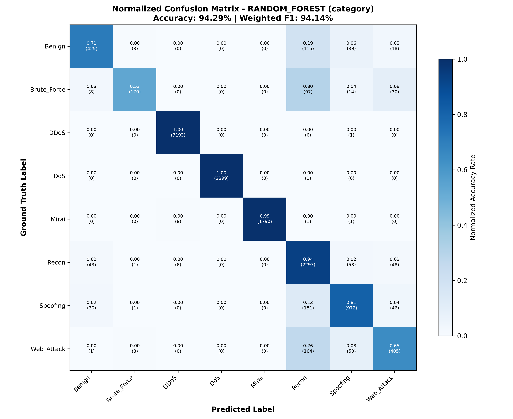

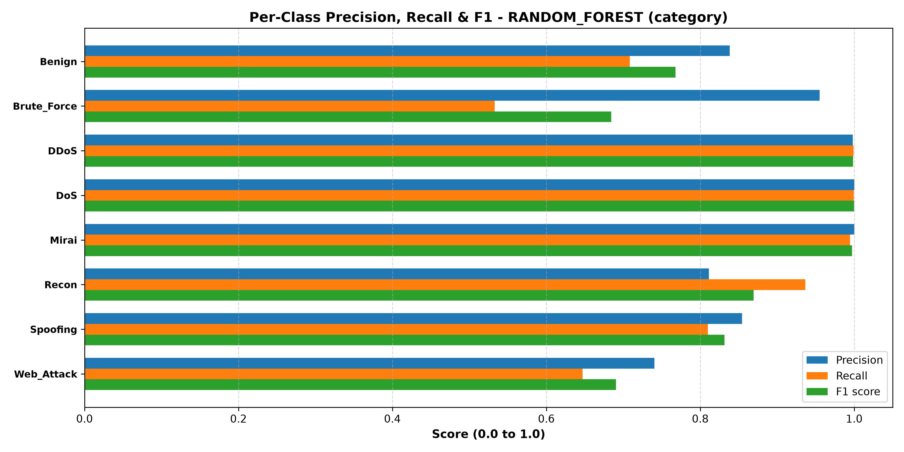

Data: [Raw confusion matrix CSV](../metrics/confusion_matrix_RANDOM_FOREST_category.csv), [Normalized confusion matrix CSV](../metrics/confusion_matrix_normalized_RANDOM_FOREST_category.csv), [Per-class metrics CSV](../metrics/class_metrics_RANDOM_FOREST_category.csv)

### EXTRA_TREES

Test samples: **16598**

| Class | Precision | Recall | F1 score | Support |
|---|---:|---:|---:|---:|
| Benign | 79.15% | 52.50% | 63.13% | 600 |
| Brute_Force | 97.53% | 24.76% | 39.50% | 319 |
| DDoS | 82.10% | 98.60% | 89.59% | 7200 |
| DoS | 93.22% | 37.83% | 53.82% | 2400 |
| Mirai | 99.94% | 99.28% | 99.61% | 1800 |
| Recon | 68.49% | 91.89% | 78.48% | 2453 |
| Spoofing | 81.23% | 73.58% | 77.22% | 1200 |
| Web_Attack | 82.23% | 43.61% | 56.99% | 626 |

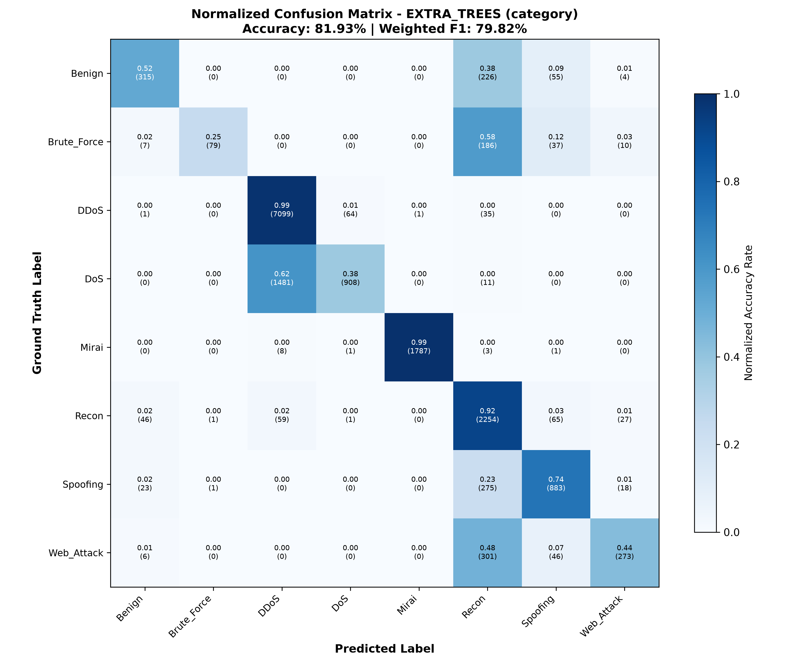

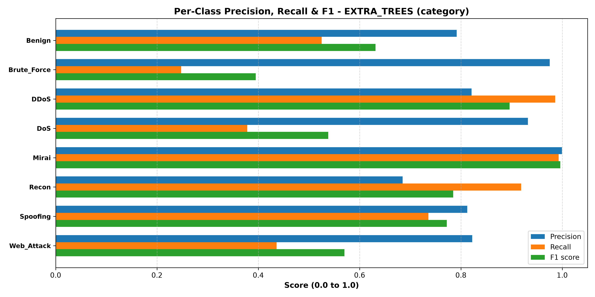

Data: [Raw confusion matrix CSV](../metrics/confusion_matrix_EXTRA_TREES_category.csv), [Normalized confusion matrix CSV](../metrics/confusion_matrix_normalized_EXTRA_TREES_category.csv), [Per-class metrics CSV](../metrics/class_metrics_EXTRA_TREES_category.csv)

### PYTORCH_MLP

Test samples: **16598**

| Class | Precision | Recall | F1 score | Support |
|---|---:|---:|---:|---:|
| Benign | 68.81% | 46.33% | 55.38% | 600 |
| Brute_Force | 81.61% | 22.26% | 34.98% | 319 |
| DDoS | 83.00% | 92.93% | 87.69% | 7200 |
| DoS | 69.76% | 43.54% | 53.62% | 2400 |
| Mirai | 99.94% | 99.39% | 99.67% | 1800 |
| Recon | 73.77% | 81.04% | 77.23% | 2453 |
| Spoofing | 78.69% | 64.92% | 71.14% | 1200 |
| Web_Attack | 40.17% | 68.85% | 50.74% | 626 |

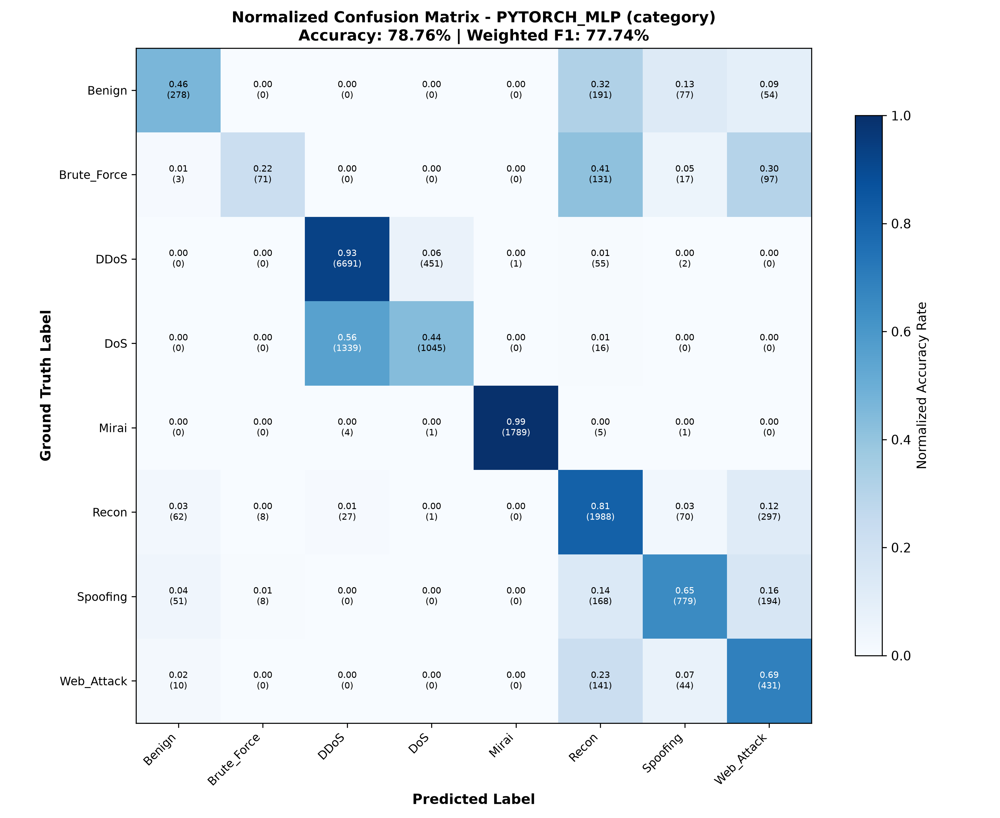

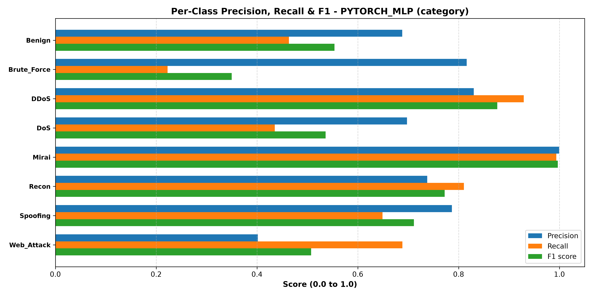

Data: [Raw confusion matrix CSV](../metrics/confusion_matrix_PYTORCH_MLP_category.csv), [Normalized confusion matrix CSV](../metrics/confusion_matrix_normalized_PYTORCH_MLP_category.csv), [Per-class metrics CSV](../metrics/class_metrics_PYTORCH_MLP_category.csv)

## Category_Shared_1000 classification

| Model | Validation weighted F1 | Validation macro F1 | Accuracy | Weighted precision | Weighted recall | Weighted F1 | Macro precision | Macro recall | Macro F1 | Train time (s) |
|---|---:|---:|---:|---:|---:|---:|---:|---:|---:|---:|
| LIGHTGBM | 91.91% | 78.12% | 92.05% | 91.82% | 92.05% | 91.78% | 81.06% | 77.01% | 78.61% | 1.07 |
| XGBOOST | 90.89% | 75.76% | 91.21% | 90.81% | 91.21% | 90.79% | 78.60% | 74.29% | 75.88% | 0.79 |
| HIST_GRADIENT_BOOSTING | 90.53% | 74.46% | 90.94% | 90.57% | 90.94% | 90.62% | 76.26% | 74.11% | 74.93% | 2.9 |
| CATBOOST | 88.97% | 71.83% | 90.05% | 90.17% | 90.05% | 89.20% | 83.28% | 70.80% | 73.01% | 3.24 |
| EXTRA_TREES | 86.60% | 68.04% | 87.33% | 87.15% | 87.33% | 86.55% | 76.59% | 66.25% | 68.43% | 0.13 |
| RANDOM_FOREST | 87.20% | 66.10% | 88.58% | 88.13% | 88.58% | 87.33% | 76.12% | 65.29% | 67.01% | 0.17 |
| PYTORCH_MLP | 69.78% | 50.78% | 72.79% | 70.52% | 72.79% | 70.13% | 62.69% | 50.65% | 51.84% | 1.93 |
| FT_TRANSFORMER_FROM_SCRATCH | 22.10% | 13.99% | 29.87% | 33.65% | 29.87% | 21.94% | 14.91% | 25.02% | 13.90% | 3.67 |

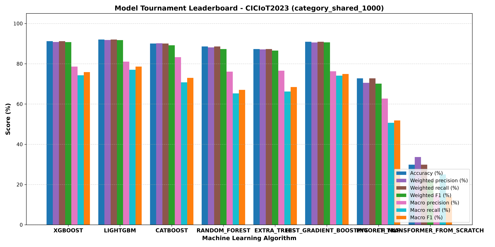

### LIGHTGBM

Test samples: **16598**

| Class | Precision | Recall | F1 score | Support |
|---|---:|---:|---:|---:|
| Benign | 71.56% | 65.00% | 68.12% | 600 |
| Brute_Force | 61.61% | 43.26% | 50.83% | 319 |
| DDoS | 99.94% | 99.62% | 99.78% | 7200 |
| DoS | 99.79% | 99.67% | 99.73% | 2400 |
| Mirai | 99.61% | 98.50% | 99.05% | 1800 |
| Recon | 78.36% | 91.81% | 84.55% | 2453 |
| Spoofing | 77.81% | 73.33% | 75.50% | 1200 |
| Web_Attack | 59.79% | 44.89% | 51.28% | 626 |

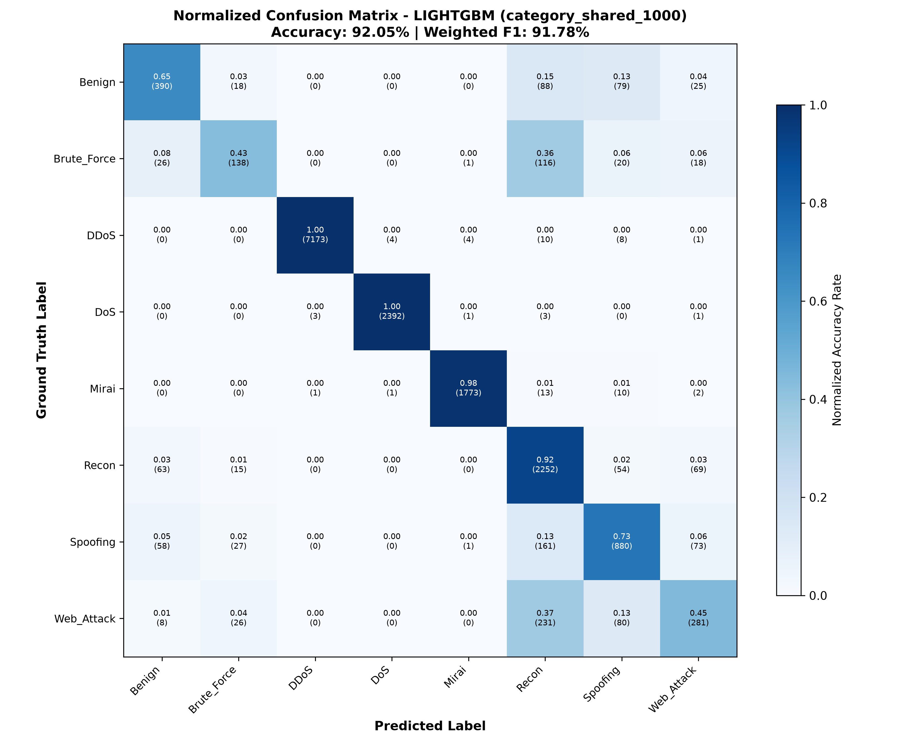

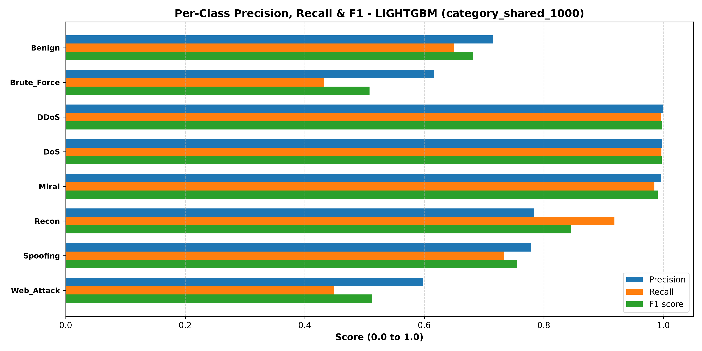

Data: [Raw confusion matrix CSV](../metrics/confusion_matrix_LIGHTGBM_category_shared_1000.csv), [Normalized confusion matrix CSV](../metrics/confusion_matrix_normalized_LIGHTGBM_category_shared_1000.csv), [Per-class metrics CSV](../metrics/class_metrics_LIGHTGBM_category_shared_1000.csv)

### XGBOOST

Test samples: **16598**

| Class | Precision | Recall | F1 score | Support |
|---|---:|---:|---:|---:|
| Benign | 75.33% | 66.67% | 70.73% | 600 |
| Brute_Force | 49.28% | 32.29% | 39.02% | 319 |
| DDoS | 99.45% | 99.62% | 99.54% | 7200 |
| DoS | 100.00% | 99.42% | 99.71% | 2400 |
| Mirai | 99.89% | 97.44% | 98.65% | 1800 |
| Recon | 75.38% | 90.50% | 82.25% | 2453 |
| Spoofing | 77.69% | 74.00% | 75.80% | 1200 |
| Web_Attack | 51.81% | 34.35% | 41.31% | 626 |

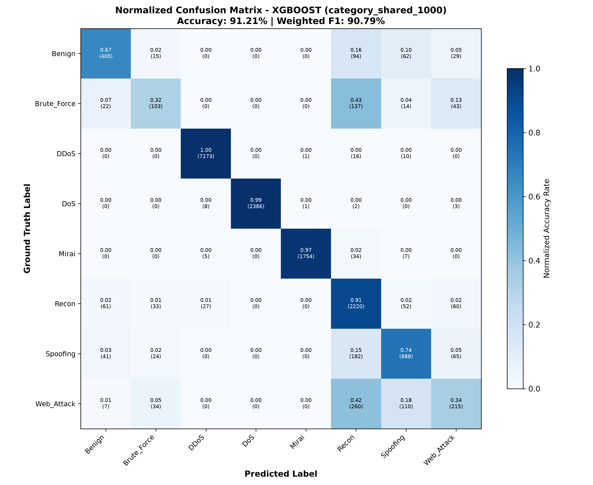

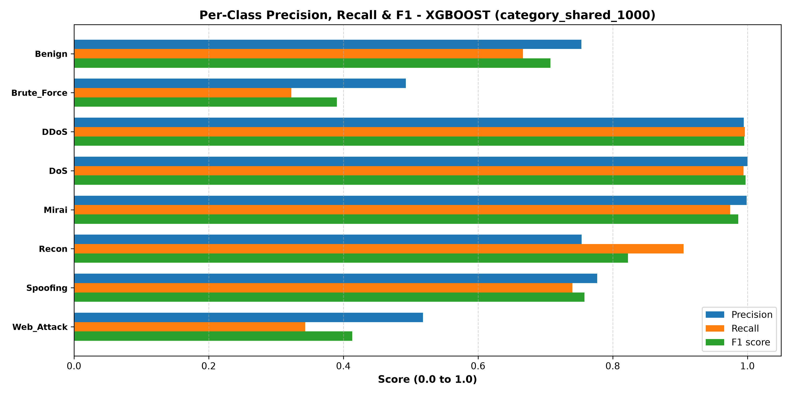

Data: [Raw confusion matrix CSV](../metrics/confusion_matrix_XGBOOST_category_shared_1000.csv), [Normalized confusion matrix CSV](../metrics/confusion_matrix_normalized_XGBOOST_category_shared_1000.csv), [Per-class metrics CSV](../metrics/class_metrics_XGBOOST_category_shared_1000.csv)

### HIST_GRADIENT_BOOSTING

Test samples: **16598**

| Class | Precision | Recall | F1 score | Support |
|---|---:|---:|---:|---:|
| Benign | 71.93% | 68.33% | 70.09% | 600 |
| Brute_Force | 41.95% | 35.11% | 38.23% | 319 |
| DDoS | 99.96% | 99.38% | 99.67% | 7200 |
| DoS | 99.75% | 99.62% | 99.69% | 2400 |
| Mirai | 99.94% | 97.17% | 98.54% | 1800 |
| Recon | 77.60% | 90.79% | 83.67% | 2453 |
| Spoofing | 74.76% | 71.33% | 73.01% | 1200 |
| Web_Attack | 44.22% | 31.15% | 36.55% | 626 |

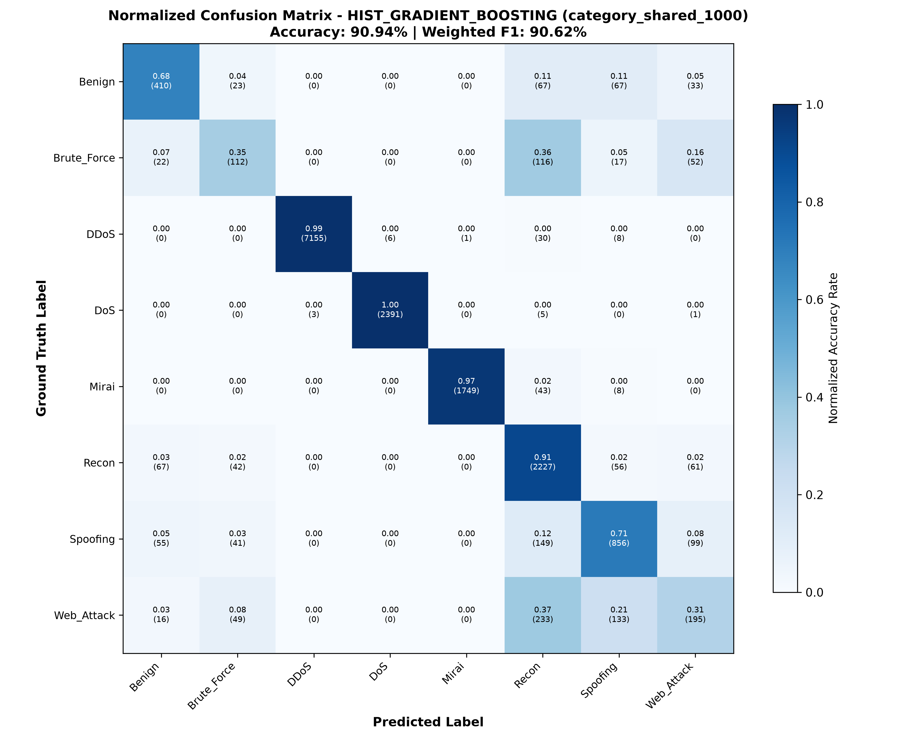

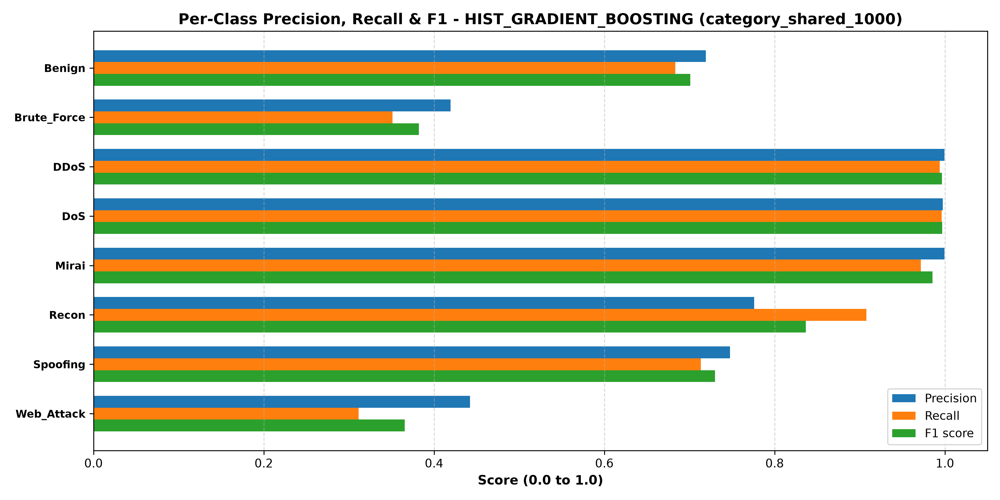

Data: [Raw confusion matrix CSV](../metrics/confusion_matrix_HIST_GRADIENT_BOOSTING_category_shared_1000.csv), [Normalized confusion matrix CSV](../metrics/confusion_matrix_normalized_HIST_GRADIENT_BOOSTING_category_shared_1000.csv), [Per-class metrics CSV](../metrics/class_metrics_HIST_GRADIENT_BOOSTING_category_shared_1000.csv)

### CATBOOST

Test samples: **16598**

| Class | Precision | Recall | F1 score | Support |
|---|---:|---:|---:|---:|
| Benign | 70.04% | 64.67% | 67.24% | 600 |
| Brute_Force | 97.14% | 21.32% | 34.96% | 319 |
| DDoS | 98.69% | 99.43% | 99.06% | 7200 |
| DoS | 99.04% | 99.33% | 99.19% | 2400 |
| Mirai | 99.89% | 98.67% | 99.27% | 1800 |
| Recon | 69.30% | 89.16% | 77.98% | 2453 |
| Spoofing | 74.75% | 69.08% | 71.81% | 1200 |
| Web_Attack | 57.41% | 24.76% | 34.60% | 626 |

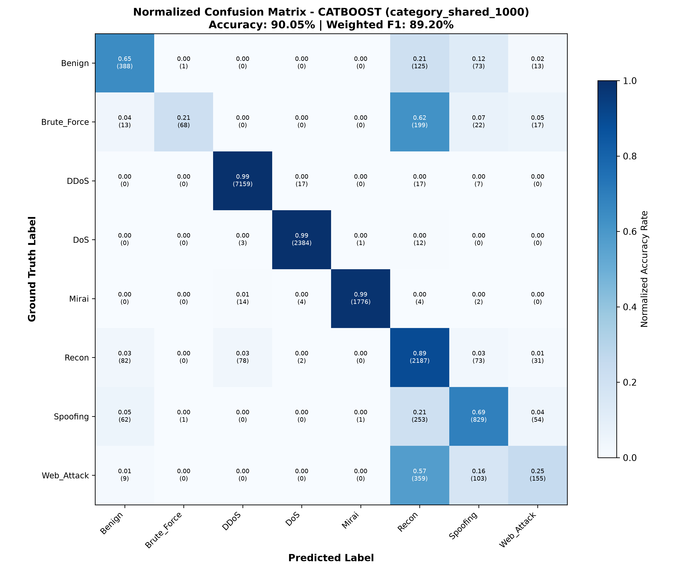

Data: [Raw confusion matrix CSV](../metrics/confusion_matrix_CATBOOST_category_shared_1000.csv), [Normalized confusion matrix CSV](../metrics/confusion_matrix_normalized_CATBOOST_category_shared_1000.csv), [Per-class metrics CSV](../metrics/class_metrics_CATBOOST_category_shared_1000.csv)

### EXTRA_TREES

Test samples: **16598**

| Class | Precision | Recall | F1 score | Support |
|---|---:|---:|---:|---:|
| Benign | 43.69% | 32.33% | 37.16% | 600 |
| Brute_Force | 80.52% | 19.44% | 31.31% | 319 |
| DDoS | 97.41% | 98.18% | 97.79% | 7200 |
| DoS | 95.38% | 94.71% | 95.04% | 2400 |
| Mirai | 99.94% | 99.00% | 99.47% | 1800 |
| Recon | 68.08% | 87.20% | 76.46% | 2453 |
| Spoofing | 65.23% | 61.92% | 63.53% | 1200 |
| Web_Attack | 62.47% | 37.22% | 46.65% | 626 |

Data: [Raw confusion matrix CSV](../metrics/confusion_matrix_EXTRA_TREES_category_shared_1000.csv), [Normalized confusion matrix CSV](../metrics/confusion_matrix_normalized_EXTRA_TREES_category_shared_1000.csv), [Per-class metrics CSV](../metrics/class_metrics_EXTRA_TREES_category_shared_1000.csv)

### RANDOM_FOREST

Test samples: **16598**

| Class | Precision | Recall | F1 score | Support |
|---|---:|---:|---:|---:|
| Benign | 65.96% | 41.67% | 51.07% | 600 |
| Brute_Force | 62.30% | 11.91% | 20.00% | 319 |
| DDoS | 98.81% | 99.58% | 99.20% | 7200 |
| DoS | 99.66% | 98.62% | 99.14% | 2400 |
| Mirai | 100.00% | 99.00% | 99.50% | 1800 |
| Recon | 64.95% | 90.42% | 75.60% | 2453 |
| Spoofing | 69.60% | 64.50% | 66.96% | 1200 |
| Web_Attack | 47.71% | 16.61% | 24.64% | 626 |

Data: [Raw confusion matrix CSV](../metrics/confusion_matrix_RANDOM_FOREST_category_shared_1000.csv), [Normalized confusion matrix CSV](../metrics/confusion_matrix_normalized_RANDOM_FOREST_category_shared_1000.csv), [Per-class metrics CSV](../metrics/class_metrics_RANDOM_FOREST_category_shared_1000.csv)

### PYTORCH_MLP

Test samples: **16598**

| Class | Precision | Recall | F1 score | Support |
|---|---:|---:|---:|---:|
| Benign | 39.54% | 17.33% | 24.10% | 600 |
| Brute_Force | 93.85% | 19.12% | 31.77% | 319 |
| DDoS | 80.10% | 90.42% | 84.95% | 7200 |
| DoS | 59.02% | 39.25% | 47.15% | 2400 |
| Mirai | 99.39% | 98.78% | 99.08% | 1800 |
| Recon | 59.46% | 81.49% | 68.75% | 2453 |
| Spoofing | 51.74% | 55.75% | 53.67% | 1200 |
| Web_Attack | 18.45% | 3.04% | 5.21% | 626 |

Data: [Raw confusion matrix CSV](../metrics/confusion_matrix_PYTORCH_MLP_category_shared_1000.csv), [Normalized confusion matrix CSV](../metrics/confusion_matrix_normalized_PYTORCH_MLP_category_shared_1000.csv), [Per-class metrics CSV](../metrics/class_metrics_PYTORCH_MLP_category_shared_1000.csv)

### FT_TRANSFORMER_FROM_SCRATCH

Test samples: **16598**

| Class | Precision | Recall | F1 score | Support |
|---|---:|---:|---:|---:|
| Benign | 0.00% | 0.00% | 0.00% | 600 |
| Brute_Force | 0.00% | 0.00% | 0.00% | 319 |
| DDoS | 58.53% | 14.68% | 23.47% | 7200 |
| DoS | 0.00% | 0.00% | 0.00% | 2400 |
| Mirai | 18.19% | 99.39% | 30.75% | 1800 |
| Recon | 42.58% | 86.06% | 56.97% | 2453 |
| Spoofing | 0.00% | 0.00% | 0.00% | 1200 |
| Web_Attack | 0.00% | 0.00% | 0.00% | 626 |

Data: [Raw confusion matrix CSV](../metrics/confusion_matrix_FT_TRANSFORMER_FROM_SCRATCH_category_shared_1000.csv), [Normalized confusion matrix CSV](../metrics/confusion_matrix_normalized_FT_TRANSFORMER_FROM_SCRATCH_category_shared_1000.csv), [Per-class metrics CSV](../metrics/class_metrics_FT_TRANSFORMER_FROM_SCRATCH_category_shared_1000.csv)

## Multiclass classification

| Model | Validation weighted F1 | Validation macro F1 | Accuracy | Weighted precision | Weighted recall | Weighted F1 | Macro precision | Macro recall | Macro F1 | Train time (s) |
|---|---:|---:|---:|---:|---:|---:|---:|---:|---:|---:|
| XGBOOST | 92.93% | 86.54% | 93.11% | 93.00% | 93.11% | 93.00% | 86.91% | 85.10% | 85.66% | 17.23 |
| HIST_GRADIENT_BOOSTING | 92.86% | 86.36% | 92.85% | 92.76% | 92.85% | 92.77% | 86.43% | 85.04% | 85.40% | 13.8 |
| CATBOOST | 91.39% | 84.40% | 91.61% | 91.76% | 91.61% | 91.46% | 87.89% | 83.02% | 84.51% | 53.44 |
| RANDOM_FOREST | 90.08% | 79.11% | 90.64% | 90.93% | 90.64% | 90.03% | 88.35% | 77.78% | 78.66% | 2.44 |
| EXTRA_TREES | 78.32% | 70.06% | 78.58% | 80.76% | 78.58% | 77.99% | 77.22% | 68.44% | 69.52% | 0.99 |
| PYTORCH_MLP | 68.29% | 59.26% | 69.79% | 71.75% | 69.79% | 68.02% | 65.86% | 59.64% | 59.09% | 27.31 |
| LIGHTGBM | 13.68% | 11.12% | 18.69% | 21.29% | 18.69% | 13.44% | 17.33% | 15.21% | 10.93% | 9.39 |

### XGBOOST

Test samples: **16598**

| Class | Precision | Recall | F1 score | Support |
|---|---:|---:|---:|---:|
| Backdoor_Malware | 58.14% | 56.18% | 57.14% | 89 |
| BenignTraffic | 78.19% | 84.83% | 81.37% | 600 |
| BrowserHijacking | 75.61% | 69.40% | 72.37% | 134 |
| CommandInjection | 66.35% | 57.98% | 61.88% | 119 |
| DDoS-ACK_Fragmentation | 100.00% | 100.00% | 100.00% | 600 |
| DDoS-HTTP_Flood | 99.66% | 99.17% | 99.42% | 600 |
| DDoS-ICMP_Flood | 100.00% | 100.00% | 100.00% | 600 |
| DDoS-ICMP_Fragmentation | 100.00% | 100.00% | 100.00% | 600 |
| DDoS-PSHACK_Flood | 100.00% | 100.00% | 100.00% | 600 |
| DDoS-RSTFINFlood | 100.00% | 100.00% | 100.00% | 600 |
| DDoS-SYN_Flood | 99.67% | 99.83% | 99.75% | 600 |
| DDoS-SlowLoris | 99.33% | 99.50% | 99.42% | 600 |
| DDoS-SynonymousIP_Flood | 100.00% | 99.83% | 99.92% | 600 |
| DDoS-TCP_Flood | 100.00% | 99.67% | 99.83% | 600 |
| DDoS-UDP_Flood | 100.00% | 100.00% | 100.00% | 600 |
| DDoS-UDP_Fragmentation | 100.00% | 99.67% | 99.83% | 600 |
| DNS_Spoofing | 76.14% | 77.67% | 76.90% | 600 |
| DictionaryBruteForce | 71.04% | 73.04% | 72.02% | 319 |
| DoS-HTTP_Flood | 100.00% | 99.83% | 99.92% | 600 |
| DoS-SYN_Flood | 100.00% | 100.00% | 100.00% | 600 |
| DoS-TCP_Flood | 99.50% | 100.00% | 99.75% | 600 |
| DoS-UDP_Flood | 100.00% | 100.00% | 100.00% | 600 |
| MITM-ArpSpoofing | 87.83% | 83.00% | 85.35% | 600 |
| Mirai-greeth_flood | 100.00% | 99.67% | 99.83% | 600 |
| Mirai-greip_flood | 99.67% | 100.00% | 99.83% | 600 |
| Mirai-udpplain | 99.67% | 99.83% | 99.75% | 600 |
| Recon-HostDiscovery | 80.96% | 87.17% | 83.95% | 600 |
| Recon-OSScan | 72.79% | 71.33% | 72.05% | 600 |
| Recon-PingSweep | 68.18% | 56.60% | 61.86% | 53 |
| Recon-PortScan | 68.62% | 74.00% | 71.21% | 600 |
| SqlInjection | 65.87% | 56.08% | 60.58% | 148 |
| Uploading_Attack | 25.00% | 3.03% | 5.41% | 33 |
| VulnerabilityScan | 99.67% | 99.50% | 99.58% | 600 |
| XSS | 63.16% | 46.60% | 53.63% | 103 |

Data: [Raw confusion matrix CSV](../metrics/confusion_matrix_XGBOOST_multiclass.csv), [Normalized confusion matrix CSV](../metrics/confusion_matrix_normalized_XGBOOST_multiclass.csv), [Per-class metrics CSV](../metrics/class_metrics_XGBOOST_multiclass.csv)

### HIST_GRADIENT_BOOSTING

Test samples: **16598**

| Class | Precision | Recall | F1 score | Support |
|---|---:|---:|---:|---:|
| Backdoor_Malware | 55.68% | 55.06% | 55.37% | 89 |
| BenignTraffic | 78.30% | 83.00% | 80.58% | 600 |
| BrowserHijacking | 72.73% | 71.64% | 72.18% | 134 |
| CommandInjection | 57.85% | 58.82% | 58.33% | 119 |
| DDoS-ACK_Fragmentation | 100.00% | 100.00% | 100.00% | 600 |
| DDoS-HTTP_Flood | 99.67% | 99.33% | 99.50% | 600 |
| DDoS-ICMP_Flood | 100.00% | 100.00% | 100.00% | 600 |
| DDoS-ICMP_Fragmentation | 99.83% | 100.00% | 99.92% | 600 |
| DDoS-PSHACK_Flood | 100.00% | 100.00% | 100.00% | 600 |
| DDoS-RSTFINFlood | 100.00% | 100.00% | 100.00% | 600 |
| DDoS-SYN_Flood | 99.67% | 99.83% | 99.75% | 600 |
| DDoS-SlowLoris | 99.17% | 99.67% | 99.42% | 600 |
| DDoS-SynonymousIP_Flood | 99.83% | 99.83% | 99.83% | 600 |
| DDoS-TCP_Flood | 99.83% | 99.83% | 99.83% | 600 |
| DDoS-UDP_Flood | 100.00% | 100.00% | 100.00% | 600 |
| DDoS-UDP_Fragmentation | 100.00% | 99.50% | 99.75% | 600 |
| DNS_Spoofing | 77.04% | 77.17% | 77.10% | 600 |
| DictionaryBruteForce | 72.00% | 73.35% | 72.67% | 319 |
| DoS-HTTP_Flood | 100.00% | 99.67% | 99.83% | 600 |
| DoS-SYN_Flood | 100.00% | 100.00% | 100.00% | 600 |
| DoS-TCP_Flood | 99.83% | 99.83% | 99.83% | 600 |
| DoS-UDP_Flood | 100.00% | 100.00% | 100.00% | 600 |
| MITM-ArpSpoofing | 85.19% | 81.50% | 83.30% | 600 |
| Mirai-greeth_flood | 99.83% | 99.67% | 99.75% | 600 |
| Mirai-greip_flood | 99.67% | 99.83% | 99.75% | 600 |
| Mirai-udpplain | 99.83% | 100.00% | 99.92% | 600 |
| Recon-HostDiscovery | 82.06% | 86.17% | 84.07% | 600 |
| Recon-OSScan | 70.87% | 69.33% | 70.09% | 600 |
| Recon-PingSweep | 68.75% | 62.26% | 65.35% | 53 |
| Recon-PortScan | 68.37% | 73.50% | 70.84% | 600 |
| SqlInjection | 62.50% | 57.43% | 59.86% | 148 |
| Uploading_Attack | 33.33% | 6.06% | 10.26% | 33 |
| VulnerabilityScan | 99.67% | 99.33% | 99.50% | 600 |
| XSS | 56.94% | 39.81% | 46.86% | 103 |

Data: [Raw confusion matrix CSV](../metrics/confusion_matrix_HIST_GRADIENT_BOOSTING_multiclass.csv), [Normalized confusion matrix CSV](../metrics/confusion_matrix_normalized_HIST_GRADIENT_BOOSTING_multiclass.csv), [Per-class metrics CSV](../metrics/class_metrics_HIST_GRADIENT_BOOSTING_multiclass.csv)

### CATBOOST

Test samples: **16598**

| Class | Precision | Recall | F1 score | Support |
|---|---:|---:|---:|---:|
| Backdoor_Malware | 71.43% | 56.18% | 62.89% | 89 |
| BenignTraffic | 71.65% | 83.83% | 77.27% | 600 |
| BrowserHijacking | 87.36% | 56.72% | 68.78% | 134 |
| CommandInjection | 82.61% | 47.90% | 60.64% | 119 |
| DDoS-ACK_Fragmentation | 99.66% | 98.83% | 99.25% | 600 |
| DDoS-HTTP_Flood | 98.13% | 96.33% | 97.22% | 600 |
| DDoS-ICMP_Flood | 100.00% | 99.67% | 99.83% | 600 |
| DDoS-ICMP_Fragmentation | 99.66% | 97.83% | 98.74% | 600 |
| DDoS-PSHACK_Flood | 99.50% | 100.00% | 99.75% | 600 |
| DDoS-RSTFINFlood | 100.00% | 99.50% | 99.75% | 600 |
| DDoS-SYN_Flood | 99.83% | 99.67% | 99.75% | 600 |
| DDoS-SlowLoris | 94.88% | 98.83% | 96.82% | 600 |
| DDoS-SynonymousIP_Flood | 99.83% | 99.83% | 99.83% | 600 |
| DDoS-TCP_Flood | 100.00% | 99.50% | 99.75% | 600 |
| DDoS-UDP_Flood | 100.00% | 99.33% | 99.67% | 600 |
| DDoS-UDP_Fragmentation | 98.99% | 97.83% | 98.41% | 600 |
| DNS_Spoofing | 73.59% | 76.17% | 74.86% | 600 |
| DictionaryBruteForce | 69.90% | 65.52% | 67.64% | 319 |
| DoS-HTTP_Flood | 98.51% | 99.50% | 99.00% | 600 |
| DoS-SYN_Flood | 99.66% | 98.50% | 99.08% | 600 |
| DoS-TCP_Flood | 99.67% | 99.50% | 99.58% | 600 |
| DoS-UDP_Flood | 99.67% | 99.67% | 99.67% | 600 |
| MITM-ArpSpoofing | 84.97% | 81.00% | 82.94% | 600 |
| Mirai-greeth_flood | 99.33% | 98.17% | 98.74% | 600 |
| Mirai-greip_flood | 98.33% | 98.33% | 98.33% | 600 |
| Mirai-udpplain | 100.00% | 99.50% | 99.75% | 600 |
| Recon-HostDiscovery | 68.80% | 84.17% | 75.71% | 600 |
| Recon-OSScan | 71.22% | 65.17% | 68.06% | 600 |
| Recon-PingSweep | 94.12% | 60.38% | 73.56% | 53 |
| Recon-PortScan | 63.57% | 74.17% | 68.46% | 600 |
| SqlInjection | 67.20% | 56.76% | 61.54% | 148 |
| Uploading_Attack | 25.00% | 3.03% | 5.41% | 33 |
| VulnerabilityScan | 96.12% | 99.17% | 97.62% | 600 |
| XSS | 75.00% | 32.04% | 44.90% | 103 |

Data: [Raw confusion matrix CSV](../metrics/confusion_matrix_CATBOOST_multiclass.csv), [Normalized confusion matrix CSV](../metrics/confusion_matrix_normalized_CATBOOST_multiclass.csv), [Per-class metrics CSV](../metrics/class_metrics_CATBOOST_multiclass.csv)

### RANDOM_FOREST

Test samples: **16598**

| Class | Precision | Recall | F1 score | Support |
|---|---:|---:|---:|---:|
| Backdoor_Malware | 100.00% | 13.48% | 23.76% | 89 |
| BenignTraffic | 67.82% | 81.83% | 74.17% | 600 |
| BrowserHijacking | 85.00% | 38.06% | 52.58% | 134 |
| CommandInjection | 68.92% | 42.86% | 52.85% | 119 |
| DDoS-ACK_Fragmentation | 99.83% | 99.00% | 99.41% | 600 |
| DDoS-HTTP_Flood | 99.15% | 97.50% | 98.32% | 600 |
| DDoS-ICMP_Flood | 100.00% | 100.00% | 100.00% | 600 |
| DDoS-ICMP_Fragmentation | 100.00% | 98.83% | 99.41% | 600 |
| DDoS-PSHACK_Flood | 100.00% | 100.00% | 100.00% | 600 |
| DDoS-RSTFINFlood | 100.00% | 99.83% | 99.92% | 600 |
| DDoS-SYN_Flood | 99.83% | 99.50% | 99.67% | 600 |
| DDoS-SlowLoris | 95.35% | 99.17% | 97.22% | 600 |
| DDoS-SynonymousIP_Flood | 99.67% | 99.67% | 99.67% | 600 |
| DDoS-TCP_Flood | 99.67% | 99.67% | 99.67% | 600 |
| DDoS-UDP_Flood | 100.00% | 99.33% | 99.67% | 600 |
| DDoS-UDP_Fragmentation | 99.49% | 98.17% | 98.83% | 600 |
| DNS_Spoofing | 72.71% | 76.83% | 74.72% | 600 |
| DictionaryBruteForce | 62.87% | 67.40% | 65.05% | 319 |
| DoS-HTTP_Flood | 99.34% | 99.67% | 99.50% | 600 |
| DoS-SYN_Flood | 99.66% | 98.83% | 99.25% | 600 |
| DoS-TCP_Flood | 99.83% | 99.50% | 99.67% | 600 |
| DoS-UDP_Flood | 99.50% | 99.83% | 99.67% | 600 |
| MITM-ArpSpoofing | 79.59% | 78.00% | 78.79% | 600 |
| Mirai-greeth_flood | 100.00% | 99.50% | 99.75% | 600 |
| Mirai-greip_flood | 99.83% | 98.83% | 99.33% | 600 |
| Mirai-udpplain | 100.00% | 99.50% | 99.75% | 600 |
| Recon-HostDiscovery | 67.58% | 86.17% | 75.75% | 600 |
| Recon-OSScan | 62.39% | 61.67% | 62.03% | 600 |
| Recon-PingSweep | 66.67% | 3.77% | 7.14% | 53 |
| Recon-PortScan | 60.98% | 75.00% | 67.26% | 600 |
| SqlInjection | 56.00% | 18.92% | 28.28% | 148 |
| Uploading_Attack | 100.00% | 3.03% | 5.88% | 33 |
| VulnerabilityScan | 95.67% | 99.50% | 97.55% | 600 |
| XSS | 66.67% | 11.65% | 19.83% | 103 |

Data: [Raw confusion matrix CSV](../metrics/confusion_matrix_RANDOM_FOREST_multiclass.csv), [Normalized confusion matrix CSV](../metrics/confusion_matrix_normalized_RANDOM_FOREST_multiclass.csv), [Per-class metrics CSV](../metrics/class_metrics_RANDOM_FOREST_multiclass.csv)

### EXTRA_TREES

Test samples: **16598**

| Class | Precision | Recall | F1 score | Support |
|---|---:|---:|---:|---:|
| Backdoor_Malware | 97.83% | 50.56% | 66.67% | 89 |
| BenignTraffic | 46.54% | 75.00% | 57.43% | 600 |
| BrowserHijacking | 88.57% | 23.13% | 36.69% | 134 |
| CommandInjection | 63.54% | 51.26% | 56.74% | 119 |
| DDoS-ACK_Fragmentation | 99.50% | 98.83% | 99.16% | 600 |
| DDoS-HTTP_Flood | 78.35% | 83.83% | 81.00% | 600 |
| DDoS-ICMP_Flood | 100.00% | 100.00% | 100.00% | 600 |
| DDoS-ICMP_Fragmentation | 100.00% | 98.83% | 99.41% | 600 |
| DDoS-PSHACK_Flood | 100.00% | 100.00% | 100.00% | 600 |
| DDoS-RSTFINFlood | 100.00% | 99.83% | 99.92% | 600 |
| DDoS-SYN_Flood | 60.69% | 94.17% | 73.81% | 600 |
| DDoS-SlowLoris | 82.99% | 79.67% | 81.29% | 600 |
| DDoS-SynonymousIP_Flood | 98.73% | 77.50% | 86.83% | 600 |
| DDoS-TCP_Flood | 66.55% | 95.50% | 78.44% | 600 |
| DDoS-UDP_Flood | 65.46% | 96.33% | 77.95% | 600 |
| DDoS-UDP_Fragmentation | 99.33% | 98.33% | 98.83% | 600 |
| DNS_Spoofing | 57.78% | 66.83% | 61.98% | 600 |
| DictionaryBruteForce | 78.45% | 44.51% | 56.80% | 319 |
| DoS-HTTP_Flood | 85.31% | 86.17% | 85.74% | 600 |
| DoS-SYN_Flood | 91.41% | 58.50% | 71.34% | 600 |
| DoS-TCP_Flood | 91.45% | 51.67% | 66.03% | 600 |
| DoS-UDP_Flood | 93.33% | 49.00% | 64.26% | 600 |
| MITM-ArpSpoofing | 73.60% | 65.50% | 69.31% | 600 |
| Mirai-greeth_flood | 98.76% | 92.67% | 95.61% | 600 |
| Mirai-greip_flood | 93.16% | 97.67% | 95.36% | 600 |
| Mirai-udpplain | 100.00% | 99.33% | 99.67% | 600 |
| Recon-HostDiscovery | 57.65% | 75.33% | 65.32% | 600 |
| Recon-OSScan | 39.56% | 36.33% | 37.88% | 600 |
| Recon-PingSweep | 83.33% | 9.43% | 16.95% | 53 |
| Recon-PortScan | 49.68% | 52.33% | 50.97% | 600 |
| SqlInjection | 45.45% | 13.51% | 20.83% | 148 |
| Uploading_Attack | 0.00% | 0.00% | 0.00% | 33 |
| VulnerabilityScan | 88.42% | 91.67% | 90.02% | 600 |
| XSS | 50.00% | 13.59% | 21.37% | 103 |

Data: [Raw confusion matrix CSV](../metrics/confusion_matrix_EXTRA_TREES_multiclass.csv), [Normalized confusion matrix CSV](../metrics/confusion_matrix_normalized_EXTRA_TREES_multiclass.csv), [Per-class metrics CSV](../metrics/class_metrics_EXTRA_TREES_multiclass.csv)

### PYTORCH_MLP

Test samples: **16598**

| Class | Precision | Recall | F1 score | Support |
|---|---:|---:|---:|---:|
| Backdoor_Malware | 42.86% | 6.74% | 11.65% | 89 |
| BenignTraffic | 52.76% | 70.17% | 60.23% | 600 |
| BrowserHijacking | 64.71% | 16.42% | 26.19% | 134 |
| CommandInjection | 65.00% | 21.85% | 32.70% | 119 |
| DDoS-ACK_Fragmentation | 98.83% | 98.67% | 98.75% | 600 |
| DDoS-HTTP_Flood | 81.20% | 79.17% | 80.17% | 600 |
| DDoS-ICMP_Flood | 100.00% | 100.00% | 100.00% | 600 |
| DDoS-ICMP_Fragmentation | 100.00% | 98.33% | 99.16% | 600 |
| DDoS-PSHACK_Flood | 99.83% | 100.00% | 99.92% | 600 |
| DDoS-RSTFINFlood | 100.00% | 99.83% | 99.92% | 600 |
| DDoS-SYN_Flood | 55.58% | 87.17% | 67.88% | 600 |
| DDoS-SlowLoris | 90.71% | 91.17% | 90.94% | 600 |
| DDoS-SynonymousIP_Flood | 88.16% | 22.33% | 35.64% | 600 |
| DDoS-TCP_Flood | 71.33% | 17.83% | 28.53% | 600 |
| DDoS-UDP_Flood | 61.99% | 86.17% | 72.11% | 600 |
| DDoS-UDP_Fragmentation | 99.49% | 98.33% | 98.91% | 600 |
| DNS_Spoofing | 40.61% | 57.33% | 47.55% | 600 |
| DictionaryBruteForce | 41.35% | 47.96% | 44.41% | 319 |
| DoS-HTTP_Flood | 84.70% | 79.33% | 81.93% | 600 |
| DoS-SYN_Flood | 43.68% | 53.00% | 47.89% | 600 |
| DoS-TCP_Flood | 52.96% | 92.33% | 67.31% | 600 |
| DoS-UDP_Flood | 77.47% | 47.00% | 58.51% | 600 |
| MITM-ArpSpoofing | 77.93% | 57.67% | 66.28% | 600 |
| Mirai-greeth_flood | 56.52% | 79.50% | 66.07% | 600 |
| Mirai-greip_flood | 65.13% | 37.67% | 47.73% | 600 |
| Mirai-udpplain | 99.67% | 99.50% | 99.58% | 600 |
| Recon-HostDiscovery | 49.57% | 77.50% | 60.47% | 600 |
| Recon-OSScan | 37.98% | 39.50% | 38.73% | 600 |
| Recon-PingSweep | 40.00% | 11.32% | 17.65% | 53 |
| Recon-PortScan | 36.15% | 20.67% | 26.30% | 600 |
| SqlInjection | 39.67% | 32.43% | 35.69% | 148 |
| Uploading_Attack | 0.00% | 0.00% | 0.00% | 33 |
| VulnerabilityScan | 87.56% | 96.17% | 91.66% | 600 |
| XSS | 35.71% | 4.85% | 8.55% | 103 |

Data: [Raw confusion matrix CSV](../metrics/confusion_matrix_PYTORCH_MLP_multiclass.csv), [Normalized confusion matrix CSV](../metrics/confusion_matrix_normalized_PYTORCH_MLP_multiclass.csv), [Per-class metrics CSV](../metrics/class_metrics_PYTORCH_MLP_multiclass.csv)

### LIGHTGBM

Test samples: **16598**

| Class | Precision | Recall | F1 score | Support |
|---|---:|---:|---:|---:|
| Backdoor_Malware | 0.00% | 0.00% | 0.00% | 89 |
| BenignTraffic | 0.00% | 0.00% | 0.00% | 600 |
| BrowserHijacking | 0.00% | 0.00% | 0.00% | 134 |
| CommandInjection | 0.00% | 0.00% | 0.00% | 119 |
| DDoS-ACK_Fragmentation | 66.67% | 0.33% | 0.66% | 600 |
| DDoS-HTTP_Flood | 0.00% | 0.00% | 0.00% | 600 |
| DDoS-ICMP_Flood | 75.37% | 84.67% | 79.75% | 600 |
| DDoS-ICMP_Fragmentation | 99.59% | 81.00% | 89.34% | 600 |
| DDoS-PSHACK_Flood | 8.57% | 10.67% | 9.50% | 600 |
| DDoS-RSTFINFlood | 0.00% | 0.00% | 0.00% | 600 |
| DDoS-SYN_Flood | 0.00% | 0.00% | 0.00% | 600 |
| DDoS-SlowLoris | 0.00% | 0.00% | 0.00% | 600 |
| DDoS-SynonymousIP_Flood | 0.00% | 0.00% | 0.00% | 600 |
| DDoS-TCP_Flood | 29.67% | 9.00% | 13.81% | 600 |
| DDoS-UDP_Flood | 36.16% | 92.33% | 51.97% | 600 |
| DDoS-UDP_Fragmentation | 30.45% | 90.33% | 45.55% | 600 |
| DNS_Spoofing | 33.33% | 0.17% | 0.33% | 600 |
| DictionaryBruteForce | 0.00% | 0.00% | 0.00% | 319 |
| DoS-HTTP_Flood | 5.43% | 92.17% | 10.26% | 600 |
| DoS-SYN_Flood | 50.00% | 0.17% | 0.33% | 600 |
| DoS-TCP_Flood | 0.00% | 0.00% | 0.00% | 600 |
| DoS-UDP_Flood | 57.14% | 1.33% | 2.61% | 600 |
| MITM-ArpSpoofing | 12.00% | 1.00% | 1.85% | 600 |
| Mirai-greeth_flood | 0.00% | 0.00% | 0.00% | 600 |
| Mirai-greip_flood | 0.00% | 0.00% | 0.00% | 600 |
| Mirai-udpplain | 83.38% | 53.50% | 65.18% | 600 |
| Recon-HostDiscovery | 1.31% | 0.33% | 0.53% | 600 |
| Recon-OSScan | 0.00% | 0.00% | 0.00% | 600 |
| Recon-PingSweep | 0.00% | 0.00% | 0.00% | 53 |
| Recon-PortScan | 0.00% | 0.00% | 0.00% | 600 |
| SqlInjection | 0.00% | 0.00% | 0.00% | 148 |
| Uploading_Attack | 0.00% | 0.00% | 0.00% | 33 |
| VulnerabilityScan | 0.00% | 0.00% | 0.00% | 600 |
| XSS | 0.00% | 0.00% | 0.00% | 103 |

Data: [Raw confusion matrix CSV](../metrics/confusion_matrix_LIGHTGBM_multiclass.csv), [Normalized confusion matrix CSV](../metrics/confusion_matrix_normalized_LIGHTGBM_multiclass.csv), [Per-class metrics CSV](../metrics/class_metrics_LIGHTGBM_multiclass.csv)

## Dataset visuals

### 34-class distribution

### Macro-category distribution

### Feature correlation

### Protocol distribution

## Raspberry Pi edge benchmark

These figures describe the machine used to run the benchmark, not necessarily a Raspberry Pi.

[Benchmark results CSV](../metrics/raspberry_pi_edge_benchmark.csv)

### Accuracy and inference latency

### Resource footprint

### Feature importance

## Dataset and interpretation notes

- The test scores apply to the cached stratified sample and should not be interpreted as full-dataset or live-network performance.
- Macro averages weight each class equally; weighted averages account for class support.
- A high accuracy with a lower macro F1 can indicate weaker performance on underrepresented classes.
- Edge benchmark latency must be measured on the actual target Raspberry Pi before deployment.
